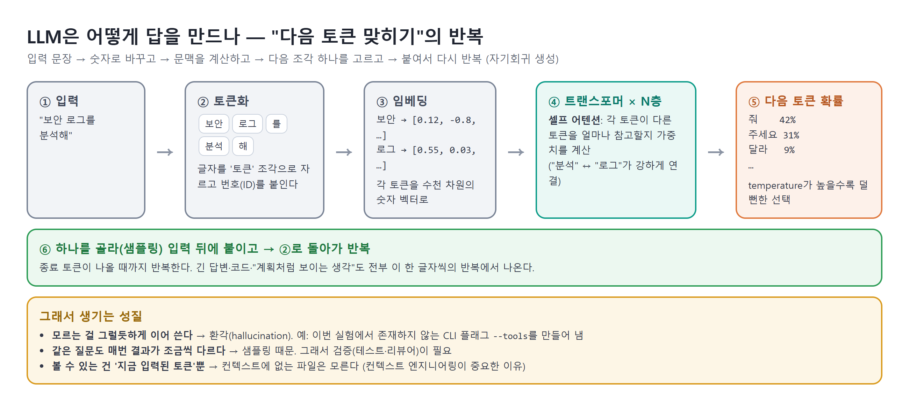
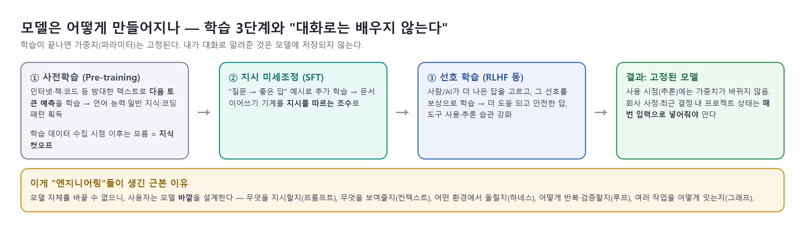
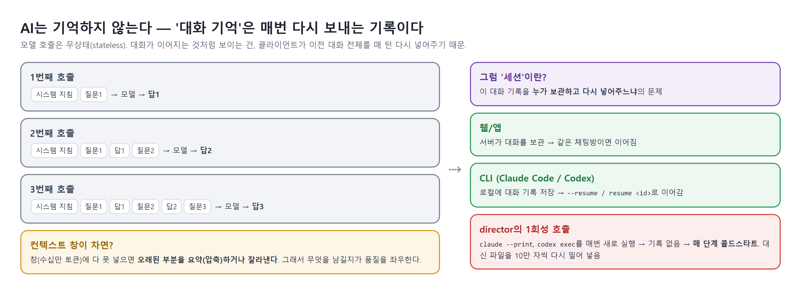
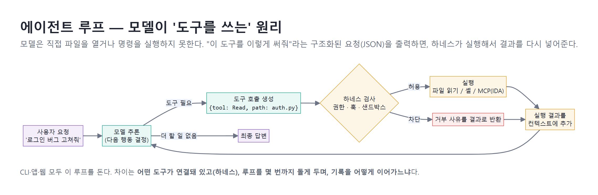
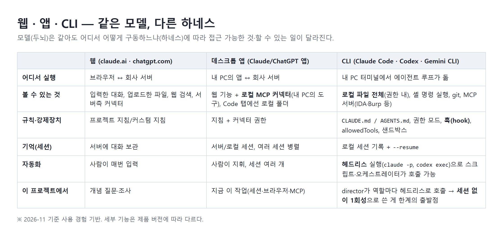

# 0. AI의 작동원리 — 모델 · 기억 · 도구 · 웹/앱/CLI

> 이 장의 목적: 뒤에 나오는 모든 "엔지니어링"과 "오케스트레이션의 실패"는 결국 **AI가 어떻게 동작하느냐**에서 출발한다.
> 특히 **"AI는 기억하지 않는다"** 와 **"AI는 도구를 직접 쓰지 못하고 요청만 한다"** 두 가지가 이해되면 나머지가 다 풀린다.

[← 목차](README.md) · [다음: 1. 5단계 구조 →](01_AI에게_일시키는_구조_5단계.md)

---

## 0.1 LLM은 어떻게 답을 만드나 — "다음 토큰 맞히기"의 반복

| 단계 | 무슨 일이 일어나나 | 실무에서 의미 |
|---|---|---|
| ② 토큰화 | 문장을 '토큰' 조각으로 자르고 번호를 붙인다 (한국어는 단어보다 잘게 쪼개지는 경우가 많음) | 요금·한도·컨텍스트 크기는 전부 **토큰 수**로 계산된다 |
| ③ 임베딩 | 토큰마다 수천 차원의 숫자 벡터로 바꾼다 | 의미가 비슷한 말은 벡터 공간에서 가깝다 |
| ④ 트랜스포머 | 여러 층에서 **셀프 어텐션**으로 "어떤 토큰이 어떤 토큰을 참고해야 하는지"를 계산 | 컨텍스트 안에 있는 정보끼리만 연결할 수 있다 |
| ⑤ 확률 분포 | 다음에 올 토큰 후보마다 확률을 낸다 | temperature가 높으면 덜 뻔한 선택 → 창의적이지만 불안정 |
| ⑥ 자기회귀 | 하나 골라 붙이고 다시 ②부터 반복 | 긴 코드·"생각하는 것처럼 보이는 추론"도 이 반복의 결과 |

**이번 실험에서 그대로 관찰된 성질**
- **그럴듯하게 지어낸다(환각)** — BUILDER가 실제 claude CLI에 없는 `--tools Read` 플래그를 만들어 썼다. 리뷰어가 잡았다. → [3장 H2](03_실험기록과_실패지점.md#h2)
- **입력에 없는 건 모른다** — 테스트 대상 파일이 컨텍스트에서 빠지자, 그 파일의 예외 클래스 이름을 **추측**해서 테스트를 썼고 4건이 실패했다. → [3장 C1](03_실험기록과_실패지점.md#c1)

## 0.2 모델은 어떻게 만들어지나 — 학습 3단계

1. **사전학습** — 방대한 텍스트로 "다음 토큰 예측"을 학습. 언어·지식·코딩 패턴을 얻지만, 데이터 수집 시점 이후는 모른다(**지식 컷오프**).
2. **지시 미세조정(SFT)** — "질문 → 좋은 답" 예시로 다듬어 *지시를 따르는 조수*가 된다.
3. **선호 학습(RLHF 등)** — 더 나은 답을 고른 데이터로 보상 학습 → 도움 되고 안전한 답, 도구 사용·단계적 추론 습관이 강화된다.

> **핵심**: 학습이 끝나면 가중치는 **고정**된다. 내가 대화로 알려준 우리 프로젝트 사정은 모델에 저장되지 않는다.
> 그래서 사용자는 모델을 바꾸는 대신 **모델 바깥(무엇을 보여주고, 어떤 환경에서, 어떻게 반복시킬지)** 을 설계한다 — 이게 1장의 5가지 엔지니어링이다.

## 0.3 AI는 기억하지 않는다 — 컨텍스트 창과 세션

- 모델 호출은 **무상태(stateless)** 다. 2번째 질문을 할 때 클라이언트(웹/앱/CLI)가 1번째 질문과 답을 **같이 다시 보내기 때문에** 대화가 이어지는 것처럼 보인다.
- 한 번에 넣을 수 있는 양이 **컨텍스트 창**(모델에 따라 수십만~백만 토큰 수준)이다. 넘치면 오래된 내용을 **요약(압축)** 하거나 잘라낸다.
- 따라서 **세션 = 대화 기록을 누가 보관하고 다시 넣어주느냐**의 문제다.

| 방식 | 기록 보관 | 이어가기 |
|---|---|---|
| 웹 / 앱 | 서버 | 같은 채팅방이면 자동 |
| CLI (Claude Code / Codex) | 로컬에 세션 기록 저장 | `claude --resume`, `codex resume <id>` |
| **director의 역할 호출** | **없음** (`claude --print`, `codex exec`를 매번 새로 실행) | **불가 → 매 단계 콜드스타트, 대신 파일을 10만 자씩 다시 주입** |

> 이 표의 마지막 줄이 이 프로젝트 전체에서 가장 중요한 발견이다. → [4장 인사이트 I2](04_AS-IS_TO-BE_리포트.md)

## 0.4 에이전트 루프 — AI가 '도구를 쓰는' 원리

- 모델은 파일을 열거나 명령을 실행하지 못한다. 대신 **"이 도구를 이 인자로 써 달라"는 구조화된 요청(JSON)** 을 출력한다.
- **하네스**(Claude Code 같은 실행 프로그램)가 그 요청을 받아 **권한·훅·샌드박스를 검사**한 뒤 실행하고, 결과를 다시 컨텍스트에 넣는다. 이걸 할 일이 없을 때까지 반복한다.
- **MCP(Model Context Protocol)** 는 이 "도구"를 외부 프로그램으로 확장하는 표준 연결 방식이다. 이번에 IDA Pro를 MCP로 붙여서 Claude가 `decompile`, `survey_binary` 같은 IDA 기능을 도구로 호출할 수 있게 했다.

> 같은 모델이라도 **어떤 도구가 연결돼 있고, 무엇이 차단되며, 루프를 몇 번 돌게 두느냐**에 따라 할 수 있는 일이 완전히 달라진다.

## 0.5 웹 · 앱 · CLI — 같은 모델, 다른 하네스

이번 작업에서 세 가지를 모두 썼다.

| 사용처 | 무엇을 했나 | 왜 그 도구였나 |
|---|---|---|
| **데스크톱 앱 (Claude Code 탭)** | 이 문서 작성, 실험 지휘, 브라우저 캡처, IDA MCP 연결 | 로컬 파일·셸·브라우저·MCP를 한 세션에서 사람이 지휘하며 사용 |
| **CLI 헤드리스** (`claude -p`, `codex exec`, `agy`) | director가 HEAD/BUILDER/REVIEWER를 호출 | 스크립트가 사람 없이 호출할 수 있는 유일한 형태 — **대신 세션이 없다** |
| **웹** | 개념 조사 | 로컬 접근 불필요 |

**헤드리스 모드**(`-p`/`exec`)는 오케스트레이터가 AI를 "함수처럼" 부를 수 있게 해 주지만, 기본 사용법대로면 **매번 새 대화**다. 이 편리함과 대가가 director의 장점이자 한계였다.

## 0.6 정리 — 뒤 장과의 연결

| 작동원리 | 그래서 필요한 것 | 다루는 곳 |
|---|---|---|
| 다음 토큰을 확률적으로 고른다 → 환각·변동 | 검증(테스트) + **독립된 검수자** | 1장 루프, 3장 H2 |
| 학습 후 고정, 컨텍스트에 있는 것만 안다 | 필요한 자료를 정확히 보여주기 | 1장 컨텍스트, 3장 C1 |
| 무상태 — 기억은 재전송 | **세션 유지** 또는 **상태를 파일로 남기기** | 4장 TO-BE |
| 도구는 하네스가 실행 | 권한·훅·샌드박스로 **강제** | 1장 하네스 |
| 웹/앱/CLI는 하네스 차이 | 용도별로 골라 조합 | 5장 도구 비교 |

### 용어 정리
| 용어 | 뜻 |
|---|---|
| 토큰 | 모델이 처리하는 텍스트 조각. 비용·한도·컨텍스트의 단위 |
| 컨텍스트 창 | 한 번의 호출에 넣을 수 있는 최대 토큰 수 |
| 환각 | 근거 없이 그럴듯한 내용을 생성하는 현상 |
| 하네스 | 모델을 감싸 도구·규칙·검증·권한을 제공하는 실행 환경 (Claude Code, Codex CLI 등) |
| 헤드리스 | 사람의 대화 화면 없이 명령 한 번으로 실행하는 모드 (`claude -p`, `codex exec`) |
| 세션 / resume | 대화 기록을 저장해 두었다가 이어서 쓰는 것 |
| MCP | 외부 프로그램(IDA, Burp 등)을 AI 도구로 연결하는 표준 프로토콜 |
| 서브에이전트 | 메인 에이전트가 일을 나눠 맡기는 별도 에이전트 (독립 컨텍스트) |
| 훅(hook) | 특정 시점(도구 실행 전·후 등)에 자동으로 실행되는 검사·명령 — 강제 장치 |

[← 목차](README.md) · [다음: 1. 5단계 구조 →](01_AI에게_일시키는_구조_5단계.md)
