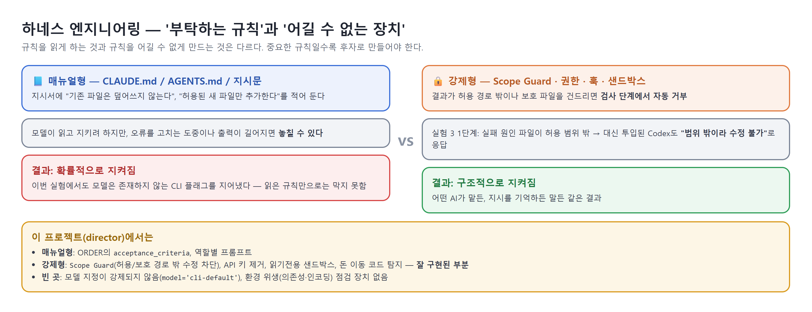
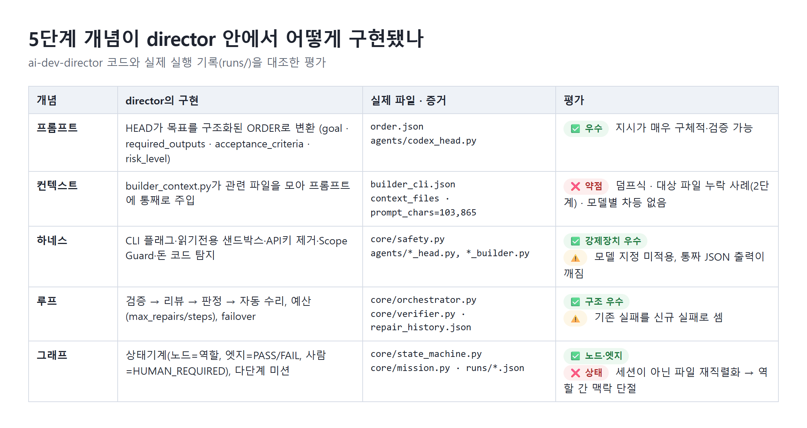

# 1. AI에게 일을 시키는 구조 5단계 — 그리고 오케스트레이션은 무엇을 구현한 것인가

> 이 장은 AI 활용 구조를 **프롬프트 → 컨텍스트 → 하네스 → 루프 → 그래프** 다섯 단계로 나눠, 이번 실험을 하면서 이해한 방식으로 다시 구성한 것이다. 설명에 쓴 사례는 모두 이번 실험(ai-dev-director)에서 실제로 일어난 일이다.
>
> 출처 — 단계 구분의 참고: 보스턴빌더 | AI 시대 생존기, 「[하네스·루프·그래프 엔지니어링? | 비개발자도 20분안에 완벽히 이해하기](https://www.youtube.com/watch?v=uKbw2Lfn3wI)」(2026-11-04)

[← 0. AI 작동원리](00_AI_작동원리.md) · [목차](README.md) · [다음: 2. 실제 동작 증적 →](02_오케스트레이션_실제동작_증적.md)

---

## 1.0 한 줄로 이해한 것

**AI에게 일을 시키는 방식은 "막히면, 모델 바깥을 한 겹 더 설계한다"의 반복이다.**

0장에서 봤듯 모델은 학습이 끝나면 바뀌지 않고, 입력에 없는 것은 모르며, 대화를 기억하지 못한다. 그래서 더 잘 시키려면 모델이 아니라 **모델을 둘러싼 것**을 바꿔야 한다 — 무엇을 지시할지, 무엇을 보여줄지, 어떤 환경에서 돌릴지, 어떻게 반복시킬지, 여러 작업을 어떻게 이을지. 다섯 단계는 이 바깥 층을 하나씩 늘려 온 순서다. 각 단계는 앞 단계로 풀리지 않는 문제가 생겨서 나왔다.

---

## 1.1 프롬프트 — 무엇을 시킬지 정확히 쓴다

**이해한 것** — 첫 단계는 지시문 자체를 잘 쓰는 것이다. 역할, 대상, 목적, 결과물 형식, 하지 말아야 할 것을 구체적으로 적을수록 모델이 "그럴듯한 추측"으로 빈칸을 채우는 일이 줄어든다. 핵심은 **결과를 확인할 수 있는 문장으로 쓰는 것**이다. "잘 만들어줘"는 확인할 수 없지만 "이 인자 배열로 호출하고 이 도구만 허용한다"는 확인할 수 있다.

**막히는 곳** — 지시가 아무리 정확해도 모델은 **우리 프로젝트의 사정**(지금 코드가 어떻게 생겼는지, 지난번에 무엇이 실패했는지, 어떤 결정을 했는지)을 모른다.

**이번 실험에서** — director의 HEAD는 한 줄 목표를 구조화된 지시서(ORDER)로 바꾼다. 인수 기준이 *"claude 호출 인자는 shell=False 인자 배열로, `--allowedTools`에 IDA MCP와 Read를 명시"* 처럼 검증 가능한 문장으로 쓰여 있었고, 다섯 단계 중 **가장 잘 작동한 부분**이었다. → [`order.json`](assets/evidence/run1_step1_FAIL/order.json)

## 1.2 컨텍스트 — 필요한 자료를 함께 보여준다

**이해한 것** — 지시와 함께 **판단에 필요한 자료**(관련 코드, 기존 결정, 실패 기록)를 넣어 주면 모델이 추측 대신 근거로 일한다. 0장의 원리 그대로, 모델은 컨텍스트에 들어온 것끼리만 연결할 수 있다. 그래서 중요한 건 "많이"가 아니라 **"필요한 것을 빠짐없이, 불필요한 것은 빼고"** 다.

**막히는 곳** — 무엇을 넣을지 **고르는 일**이 남는다. 사람이 매번 고르면 번거롭고, 규칙으로 자동 선택하면 엉뚱한 것을 넣거나 중요한 것을 빠뜨린다.

**이번 실험에서** — 정확히 이 문제가 터졌다. director는 관련 파일을 모아 BUILDER에게 **매번 약 10만 자**를 통째로 넣었는데, 2단계 런에서는 **테스트 대상 파일이 빠지고** 무관한 대시보드 문서가 들어갔다. BUILDER는 본 적 없는 클래스의 예외 이름을 **추측**해 테스트를 썼고 4건이 실패했다. → [3장 C1](03_실험기록과_실패지점.md#c1)

> 여기서 얻은 결론: 자료를 밖에서 골라 밀어 넣는 대신, **에이전트가 스스로 파일을 열어 보고 찾게** 하는 편이 정확하다. 그러려면 도구를 쓸 수 있는 환경이 필요하다 → 다음 단계.

## 1.3 하네스 — 일할 환경을 만들고, 규칙은 강제한다

**이해한 것** — 하네스는 모델을 감싸는 **실행 환경**이다. 어떤 도구(파일 읽기·셸·MCP)를 쓸 수 있는지, 무엇은 절대 못 하는지, 결과를 어떻게 검사하는지, 실패하면 어떻게 되돌리는지를 정한다. 여기서 구분해야 할 게 두 가지다.
- **매뉴얼형 규칙** — `CLAUDE.md`, 지시문의 "하지 마라". 모델이 읽고 *지키려고 노력*한다. 확률적이다.
- **강제형 장치** — 권한, 훅, 샌드박스, 경로 검사. 위반이면 *실행 자체가 막힌다*. 구조적이다.

하네스의 핵심은 후자다. 중요한 규칙일수록 "부탁"이 아니라 "어길 수 없는 장치"로 만들어야 한다.

**막히는 곳** — 환경을 잘 만들어도, 결과물이 맞는지 확인하고 틀리면 다시 시키는 일은 여전히 누군가 해야 한다.

**이번 실험에서**
- ✅ **강제형이 제대로 작동했다.** director의 Scope Guard는 지시서의 허용 경로 밖을 고치면 결과를 거부한다. 실험 3 1단계에서 실패 원인 파일이 허용 경로 밖에 있었는데, 대신 투입된 Codex도 *"allowed_paths 밖이라 현재 ORDER로는 수정 불가"* 라며 아무것도 바꾸지 않았다. → [`builder_cli.json`](assets/evidence/run1_step1_FAIL/builder_cli.json)
- ⚠️ **빈 곳도 있었다.** 역할별 모델 지정이 강제되지 않았고(각 CLI 기본 모델로 실행), 결과를 거대한 JSON 하나로 돌려받는 **출력 형식**이 큰 결과에서 깨졌다. 출력 형식도 하네스의 일부라는 걸 여기서 알았다. → [3장 H1·H4](03_실험기록과_실패지점.md#h1)

## 1.4 루프 — 확인과 재지시를 반복 구조로 만든다

**이해한 것** — 사람이 하던 "결과 확인 → 틀린 곳 지적 → 다시 시키기"를 **시스템이 반복**하게 하는 것이다. 작업 → 검사 → 판정 → 수정을 기준을 통과할 때까지 돈다. 다만 무작정 반복하면 같은 오류에 갇히거나 엉뚱한 방향으로 계속 고친다. 그래서 루프를 만들기 전에 세 가지를 먼저 정해야 한다.

| 먼저 정할 것 | 의미 | 이번 실험에서 |
|---|---|---|
| **무엇이 성공인가** | 검증 가능한 통과 기준 | ⚠️ **기준이 흔들렸다.** 테스트가 0개 실행됐는데 통과로 보기도 했고(실험 1·2), 무관한 기존 실패 하나로 떨어뜨리기도 했다(실험 3). 키워드 필터가 엉뚱한 테스트를 포함하기도 했다 → [3장 L1·L4·P1](03_실험기록과_실패지점.md#l1) |
| **누가 검증하나** | 만든 AI와 다른 검증자 | ✅ **가장 가치 있었다.** 별도 리뷰어가 존재하지 않는 CLI 플래그(`--tools`), 추측으로 쓴 테스트를 잡아냈고, HEAD는 게이트의 거짓 통과를 "증거와 모순"이라며 뒤집었다 |
| **언제 멈추나** | 최대 반복 횟수, 중단 후 보고 | ✅ 단계 예산이 무한 반복을 막았다. 다만 멈춘 뒤 결과가 숨김 폴더에 있어 사람이 바로 볼 수 없었다 |

**막히는 곳** — 루프는 **한 가지 작업**의 완성도를 높인다. 작업이 여러 개로 나뉘고 서로 결과를 주고받아야 하면, 어디서 무엇을 넘기고 어디로 되돌아갈지를 따로 설계해야 한다.

## 1.5 그래프 — 역할 · 조건 · 상태로 전체 흐름을 설계한다

**이해한 것** — 여러 작업을 **노드**(작업 단위)로 나누고, **엣지**(조건이 붙은 경로)로 잇고, **상태**(앞 작업의 결과·결정을 다음 작업이 이어받는 기록)를 관리하는 설계다. 실패하면 처음부터가 아니라 **문제가 난 노드로만** 되돌아간다. 노드가 꼭 AI일 필요는 없다 — 단순 검사는 일반 프로그램(pytest)이, 위험한 결정은 사람이 맡는다.

멀티 에이전트 오케스트레이션과의 차이도 이렇게 이해했다. **오케스트레이션은 "여러 AI를 어떻게 협업시키나"**, **그래프는 AI·프로그램·사람을 포함한 "전체 작업이 어떤 조건과 경로로 흐르나"** 에 초점이 있다. 루프는 그래프 안에 들어가는 한 부분이다.

**이번 실험에서**

| 요소 | director의 구현 | 평가 |
|---|---|---|
| 노드 | HEAD·BUILDER·REVIEWER(AI), pytest(프로그램), HUMAN_REQUIRED(사람) | ✅ |
| 엣지 | 판단 FAIL → 구현으로, 예산 소진 → 정지, 위험 작업 → 사람 승인 | ✅ |
| 상태 | 역할 사이의 정보를 **세션이 아니라 파일·JSON으로 매번 다시 조립** | ❌ **여기서 무너졌다** |

상태가 끊기니 모든 노드가 매 단계 처음부터 시작했고, 그 결과가 10만 자 재주입, 대상 파일 누락, 대행 AI의 맥락 소실이었다. 또 HEAD가 *"I will proceed with this task."* 라고 답한 직후 *"프로젝트 선택이 유효하지 않습니다"* 오류가 났다 — AI의 말과 실제 시스템 상태가 따로 놀았다. 그래서 **사람이 확인해야 완료되는 노드**도 필요하다. → [2장 2.6](02_오케스트레이션_실제동작_증적.md#ai-chat), [3장 G1·G2](03_실험기록과_실패지점.md#g1)

---

## 1.6 그래서 오케스트레이션은 무엇을 구현한 것인가

director는 **루프(4단계)를 여러 AI 역할로 나눠 돌리고, 그 전체를 상태기계(5단계 그래프)로 묶은 것**이다. 다섯 단계를 한 프로그램에 모두 구현하려는 시도였다.

| 단계 | 구현 수준 | 한 줄 평가 |
|---|---|---|
| 프롬프트 | ✅ 우수 | 지시서가 구체적이고 검증 가능 |
| 컨텍스트 | ❌ 약점 | 파일 덤프 방식, 대상 파일 누락 |
| 하네스 | ✅ / ⚠️ | 강제장치는 우수, 모델 지정·출력 형식은 약점 |
| 루프 | ✅ / ⚠️ | 검증자·종료 조건은 우수, **성공 기준이 양방향으로 틀림** |
| 그래프 | ✅ / ❌ | 노드·엣지는 좋음, **상태가 세션이 아니라 파일 재조립** |

> **이 장의 결론** — director는 다섯 단계를 거의 다 갖춘 잘 설계된 그래프였다. 무너진 곳은 두 군데다: 그래프의 **상태**를 기억 없이 파일로만 넘긴 것, 루프의 **성공 기준**이 흔들린 것. 이 두 지점이 [4장 TO-BE](04_AS-IS_TO-BE_리포트.md) 설계의 출발점이다.

[← 0. AI 작동원리](00_AI_작동원리.md) · [목차](README.md) · [다음: 2. 실제 동작 증적 →](02_오케스트레이션_실제동작_증적.md)
