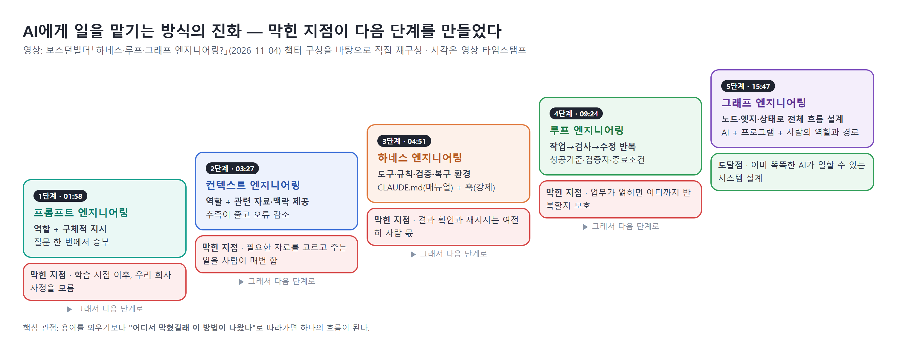
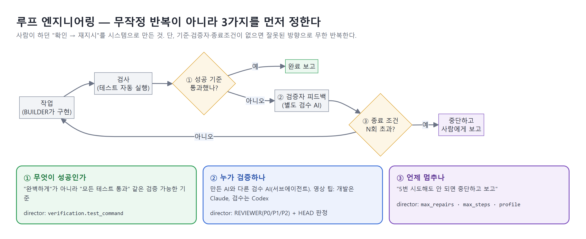
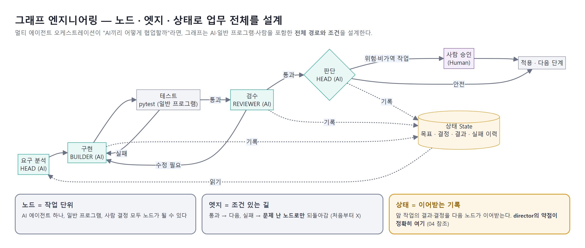

# 1. AI에게 일을 시키는 구조 5단계 — 그리고 오케스트레이션은 무엇을 구현한 것인가

> 개념 출처: 보스턴빌더 | AI 시대 생존기 —「[하네스·루프·그래프 엔지니어링? | 비개발자도 20분안에 완벽히 이해하기](https://www.youtube.com/watch?v=uKbw2Lfn3wI)」(2026-11-04, 22분)
> 영상의 흐름을 내 말로 다시 정리하고, **각 단계가 이번 실험(director)에서 어떻게 구현됐고 실제로 어떻게 동작/실패했는지**를 붙였다. 도식은 모두 직접 그린 것이다.

[← 0. AI 작동원리](00_AI_작동원리.md) · [목차](README.md) · [다음: 2. 실제 동작 증적 →](02_오케스트레이션_실제동작_증적.md)

---

## 1.0 한 장 요약 — 막힌 지점이 다음 단계를 만들었다

영상의 가장 중요한 관점은 이거다: **용어를 외우지 말고 "어디서 막혔길래 이 방법이 나왔나"로 따라가면 하나의 흐름**이 된다. 그리고 결론은 "AI를 더 똑똑하게 만드는 것"이 아니라 **"이미 똑똑한 AI가 제대로 일할 수 있는 시스템을 만드는 것"** 이다.

영상의 도입부 장면(AI가 "다 됐습니다"라고 했는데 실제론 안 돼 있는 상황)은 이번 실험에서도 **그대로 재현됐다** — HEAD가 "I will proceed with this task."라고 답한 직후 "프로젝트 선택이 유효하지 않습니다" 오류가 났다. ([2장 2.6](02_오케스트레이션_실제동작_증적.md#ai-chat), [3장 G2](03_실험기록과_실패지점.md#g2))

---

## 1.1 프롬프트 엔지니어링 — 한 번의 지시를 잘 쓰기
▶ 영상 [01:58](https://www.youtube.com/watch?v=uKbw2Lfn3wI&t=118s)

| | 내용 |
|---|---|
| **방법** | 역할을 주고("너는 10년차 마케터"), 대상·목적·형식을 구체적으로 지시한다. 질문 한 번 안에서 승부를 본다 |
| **막힌 지점** | 모델은 학습 시점까지의 일반 지식만 안다 → **우리 회사 사정, 지난번에 왜 실패했는지, 회의에서 정한 것**을 모른다 (0장 0.2의 지식 컷오프) |
| **director에서** | HEAD가 목표를 **구조화된 ORDER**로 바꾼다 — `goal`, `required_outputs`, `allowed_paths`, `acceptance_criteria`, `risk_level`. 이번 실험에서 가장 잘 작동한 부분 |
| **실제 증거** | [`order.json`](assets/evidence/run1_step1_FAIL/order.json) — 인수 기준이 "shell=False 인자 배열로 호출", "`--allowedTools`에 IDA MCP와 Read 명시"처럼 **검증 가능한 문장**으로 쓰여 있다 |

## 1.2 컨텍스트 엔지니어링 — 지시와 함께 자료를 준다
▶ 영상 [03:27](https://www.youtube.com/watch?v=uKbw2Lfn3wI&t=207s)

| | 내용 |
|---|---|
| **방법** | 역할 + **관련 자료·맥락**(고객 정보, 지난 성과, 회의록)을 함께 준다 → 추측이 줄고 오류가 감소 |
| **막힌 지점** | 어떤 자료가 필요한지 **고르고 전달하는 일을 사람이 매번** 해야 한다 → 그래서 AI가 직접 찾아오게 하자(하네스로) |
| **director에서** | `core/builder_context.py`가 관련 파일을 모아 BUILDER 프롬프트에 **통째로** 넣는다 (1회 약 10만 자) |
| **실제로 어땠나** | ❌ **가장 약한 고리**. 2단계 런에서 **테스트 대상 파일이 컨텍스트에서 빠지고**, 대신 무관한 파일(`antigravity_builder.py`, `DASHBOARD_WORKSPACE_V2.md`)이 들어갔다 → BUILDER가 예외 클래스 이름을 추측 → 계약 테스트 4건 실패 ([3장 C1](03_실험기록과_실패지점.md#c1)) |

> 교훈: 컨텍스트는 "많이"가 아니라 **"정확히"** 다. 그리고 에이전트가 세션 안에서 스스로 `Read`/`Grep`으로 찾게 하면 이 선택 실수 자체가 줄어든다.

## 1.3 하네스 엔지니어링 — 일할 환경을 만들고, 규칙을 강제한다
▶ 영상 [04:51](https://www.youtube.com/watch?v=uKbw2Lfn3wI&t=291s)

| | 내용 |
|---|---|
| **방법** | AI를 더 똑똑하게 만드는 대신 **도구 연결·규칙·검증·복구 체계**를 만든다. 말에 채우는 마구(harness)처럼 방향을 잡고 통제한다 |
| **핵심 구분** | `CLAUDE.md`는 **읽고 지켜 달라는 매뉴얼**, **훅**은 위험한 행동을 **실행 전에 막는 출입문**. 하네스의 철학은 "AI가 규칙을 어기고 싶어도 어길 수 없는 환경" |
| **막힌 지점** | 결과를 확인하고 다시 지시하는 일은 여전히 사람 몫 |
| **director에서** | ✅ 강제장치가 우수하다: **Scope Guard**(허용/보호 경로 밖 수정 차단), API 키 제거(구독만 사용 강제), 읽기전용 샌드박스, 돈 이동 코드 탐지. ⚠️ 빈 곳: 모델 지정이 강제되지 않음(`model='cli-default'`), 출력 형식(통짜 JSON)이 큰 결과에서 깨짐 |
| **실제 증거** | 실험 3의 1단계 ORDER는 `allowed_paths`가 새 파일 5개뿐이라, 기존 테스트 실패의 원인 파일(`core/research_prompts.py`)은 손댈 수 없었다. 대행 Codex는 이를 지키며 **"allowed_paths 밖이라 현재 ORDER로는 수정 불가"** 라고 변경 없이 응답했다 → 강제장치는 제대로 작동 ([`builder_cli.json`](assets/evidence/run1_step1_FAIL/builder_cli.json)) |

## 1.4 루프 엔지니어링 — 확인·재지시를 시스템으로
▶ 영상 [09:24](https://www.youtube.com/watch?v=uKbw2Lfn3wI&t=564s)

영상은 루프에서 **먼저 정해야 할 3가지**를 강조한다. director는 셋 다 구현했지만, 각각에서 실패가 났다.

| 3질문 | director의 구현 | 실제로 어땠나 |
|---|---|---|
| ① **무엇이 성공인가** | `verification.test_command` 통과 + 필수 산출물 존재 | ⚠️ 기준 자체가 흔들렸다: 테스트 0개 실행을 통과로 보거나(실험 1·2), 무관한 기존 실패로 탈락시키거나(실험 3). 키워드 필터가 엉뚱한 테스트를 포함 ([3장 L1·L4·P1](03_실험기록과_실패지점.md#l1)) |
| ② **누가 검증하나** | 별도 REVIEWER(Antigravity) + HEAD 최종 판정 | ✅ **가장 가치 있었다.** 존재하지 않는 CLI 플래그, 추측으로 쓴 테스트를 잡아냈고, 게이트의 거짓 통과도 "증거와 모순"이라며 뒤집었다 |
| ③ **언제 멈추나** | `max_repairs`, `max_steps`, 프로파일(quick 2 / standard 6) | ✅ 무한루프 없이 멈췄다. 단, 멈춘 뒤 결과가 숨김 폴더에 있어 사람이 못 봤다 |

영상의 팁 "개발은 Claude, 검수는 Codex"는 director의 기본 철학과 같다. 그리고 영상의 ERP 사례("AI가 고쳤다고 끝이 아니라 **사용자가 '해결됐어요'를 눌러야 완료**")는 TO-BE의 **사람 승인 게이트**로 이어진다. ([4장](04_AS-IS_TO-BE_리포트.md))

## 1.5 그래프 엔지니어링 — 노드 · 엣지 · 상태로 전체를 설계
▶ 영상 [15:47](https://www.youtube.com/watch?v=uKbw2Lfn3wI&t=947s) · 오케스트레이션과의 차이 [18:17](https://www.youtube.com/watch?v=uKbw2Lfn3wI&t=1097s)

| 요소 | 뜻 | director에서 |
|---|---|---|
| **노드** | 작업 단위. AI·일반 프로그램·사람 모두 가능 | HEAD/BUILDER/REVIEWER(AI), pytest(프로그램), HUMAN_REQUIRED(사람) ✅ |
| **엣지** | 조건 있는 경로. 실패하면 **문제 난 노드로만** 되돌아감 | DECIDING → FAIL이면 BUILDING으로, 예산 소진이면 STOP ✅ |
| **상태** | 앞 작업의 결과·결정을 다음 노드가 **이어받는** 기록 | ❌ **세션이 아니라 파일**. 매 노드가 새로 시작하고 Director가 파일을 다시 조립해 넣어준다 |

---

## 1.6 그래서 "오케스트레이션"은 무엇을 구현한 것인가

영상의 구분([18:17](https://www.youtube.com/watch?v=uKbw2Lfn3wI&t=1097s)): **멀티 에이전트 오케스트레이션**은 "여러 AI를 어떻게 협업시킬까"에 집중하고, **그래프 엔지니어링**은 AI·프로그램·사람을 포함해 **전체 업무의 순서·조건·경로**를 설계한다.

director를 이 틀로 보면 — **루프(4단계)를 여러 AI 역할로 나눠 돌리고, 그 전체를 상태기계(5단계 그래프)로 묶은 것**이다. 즉 1~5단계를 한 프로그램에 다 구현하려는 시도였다.

| 단계 | 구현 수준 | 한 줄 평가 |
|---|---|---|
| 프롬프트 | ✅ 우수 | ORDER가 구체적·검증 가능 |
| 컨텍스트 | ❌ 약점 | 덤프식, 대상 파일 누락 사례 |
| 하네스 | ✅ / ⚠️ | 강제장치 우수, 모델 지정·출력 형식은 약점 |
| 루프 | ✅ / ⚠️ | 구조 우수, **성공 기준(판정 게이트)이 양방향으로 틀림** |
| 그래프 | ✅ / ❌ | 노드·엣지는 좋음, **상태가 세션이 아니라 파일 재조립** |

> **이 장의 결론**: director는 영상이 말하는 5단계를 거의 다 갖춘 **잘 설계된 그래프**였다. 그런데 그래프의 세 요소 중 **'상태'를 기억(세션) 없이 파일로만 넘긴 것**, 그리고 **루프의 '성공 기준'이 흔들린 것** 두 곳에서 무너졌다. 이 두 지점이 4장 TO-BE 설계의 출발점이다.

[← 0. AI 작동원리](00_AI_작동원리.md) · [목차](README.md) · [다음: 2. 실제 동작 증적 →](02_오케스트레이션_실제동작_증적.md)
