# 2. 오케스트레이션 실제 동작 증적 — 화면 · JSON · AI 간 대화

> 이 장은 **주장이 아니라 증거**다. 모든 화면은 director 콘솔(TRINITY)의 **다시보기(실제 기록 재생)** 를 자동 캡처한 것이고,
> 모든 JSON은 실행 폴더 `runs/RUN-…/`의 원본을 발췌한 것이다(원본 파일: [`assets/evidence/`](assets/evidence/)).
> 기준 런: **실험 3의 1단계 `RUN-261118000344`** (standard 프로파일, 2026-11-18 00:03:44 ~ 00:18:09).

[← 1. 5단계 구조](01_AI에게_일시키는_구조_5단계.md) · [목차](README.md) · [다음: 3. 실험과 실패 지점 →](03_실험기록과_실패지점.md)

---

## 2.1 등장인물 — 역할과 실제 실행 방식

| 역할 | 하는 일 | 배정 (의도) | 실제 호출 | 세션 |
|---|---|---|---|---|
| **HEAD** | 목표 해석 → ORDER 작성 → 최종 판단 → 다음 단계 계획 | Codex (gpt-6-astra) | `codex exec --sandbox read-only -` | 없음* |
| **BUILDER** | ORDER대로 구현해 **파일 전체를 JSON으로** 반환 | Claude (opus) | `claude --print --output-format json` | 없음 |
| **DIRECTOR** | 기준선·변경본 테스트, Scope Guard, 상태 전이, failover | (일반 프로그램) | `python -m pytest …` | — |
| **REVIEWER** | diff와 테스트 결과를 독립 검수 (P0/P1/P2) | Antigravity (gemini) | `agy … stream-json` | 없음 |
| **MENTOR** | 끝난 뒤 내 학습 포인트 브리핑 (내가 추가) | Gemini | `agy --model …` | 없음 |

\* 이후 Codex와 함께 HEAD에 프로젝트별 세션을 붙이는 수정을 진행해 테스트 6/6 통과까지 확인했다 → [4장 Phase 0](04_AS-IS_TO-BE_리포트.md).
※ codex/claude는 director가 `--model`을 넘기지 않아 **각 CLI 계정의 기본 모델**로 돈다 (`core/role_settings.py`의 `model='cli-default'`).

## 2.2 콘솔 화면 구성

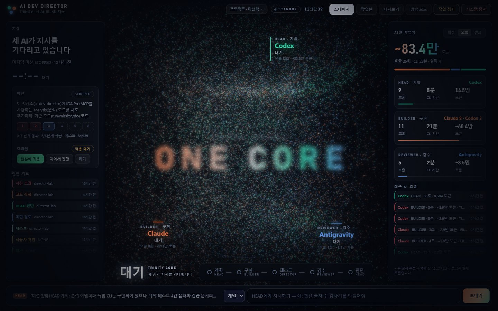
*TRINITY 스테이지(대기). 가운데 세 AI 코어, 하단에 [계획→구현→테스트→검수→판단] 진행 표시, 좌측 "지금" 패널과 미션 단계(1~6), 우측 **AI별 작업량**(호출 수·CLI 시간·토큰)과 **최근 AI 호출** 목록.*

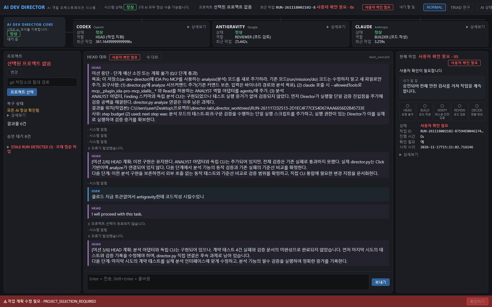
*Command Center(작업실). 세 AI의 상태, 프로젝트·복구 상태, **HEAD 대화**(AI가 사람에게 보고한 내용), 우측 현재 작업의 단계와 오류 코드(`PROJECT_SELECTION_REQUIRED`, `STALE RUN DETECTED`)가 보인다.*

## 2.3 상태기계 — 화면의 5단계와 실제 상태의 대응

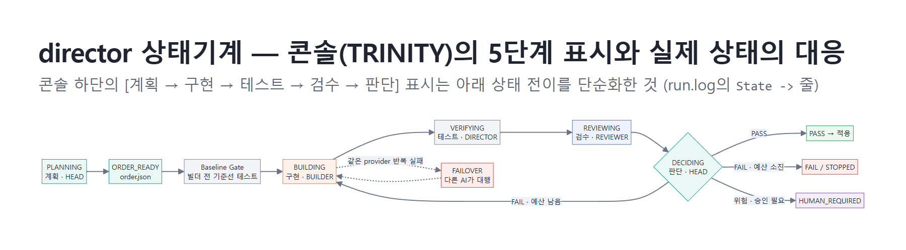

실제 로그(`run.log`)의 상태 전이 — 이 순서가 화면의 단계 표시로 그대로 나타난다:

```text
00:03:45 State -> PLANNING
00:03:45 State -> ORDER_READY
00:03:47 Isolated worktree created at …\.director_worktrees\RUN-261118000344-…
00:03:47 [Baseline Gate] Running tests on clean worktree before builder execution...
00:04:07 [HEAD proxy] BASELINE_PREEXISTING_FAILURES: … test_d_reviewer_findings_land_in_research_memory
00:04:07 State -> BUILDING
00:06:30 [HEAD proxy] Builder attempt 1/3 on ANTHROPIC failed: Invalid control character at: line 1 column 11155
00:11:06 State -> VERIFYING
00:11:06 [HEAD proxy] waived on the user's behalf: Max diff lines exceeded: 513 > 500
00:11:23 State -> REVIEWING
00:11:56 State -> DECIDING
00:12:18 State -> BUILDING (automatic correction round 1)
   …  (수리 2회차에서 같은 JSON 오류 반복)
00:16:55 [FAILOVER] BUILDING: BUILDER ANTHROPIC -> OPENAI (failed repeatedly earlier in this run)
00:18:09 Final State -> FAIL
```
원본: [`run.log`](assets/evidence/run1_step1_FAIL/run.log)

---

## 2.4 단계별 실제 동작 — 화면 + 그 단계에서 오간 JSON

### ① 계획 — HEAD가 목표를 ORDER로 만든다

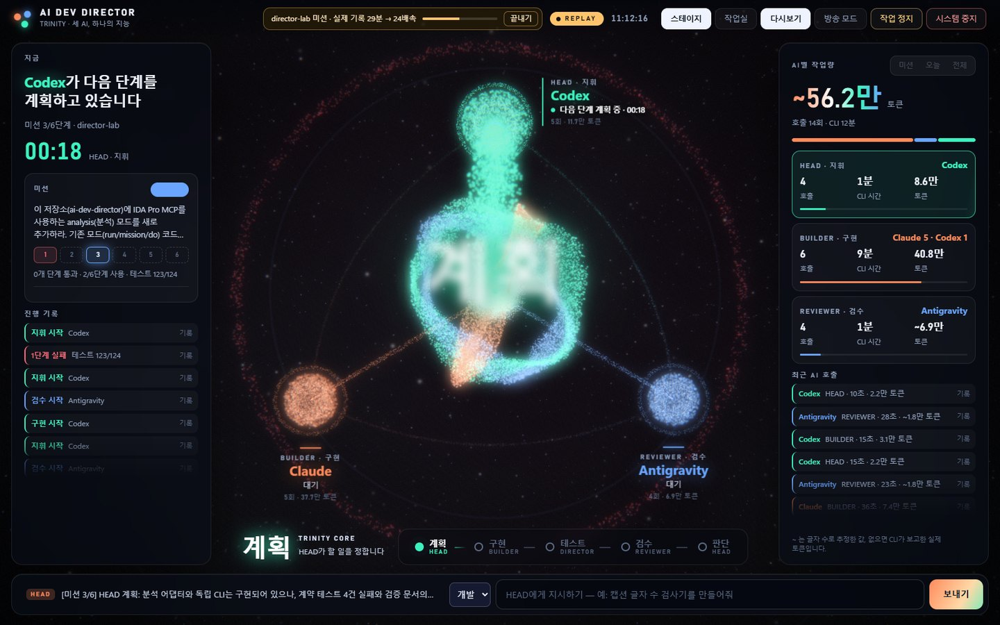
*HEAD(Codex)가 다음 단계를 계획 중. 하단 진행 표시가 "계획 · HEAD"에 불이 들어와 있다.*

HEAD → BUILDER로 넘어가는 지시서 [`order.json`](assets/evidence/run1_step1_FAIL/order.json) (발췌):
```json
{
  "goal": "IDA Pro MCP 기반 ANALYST 어댑터, Finding 스키마, 독립 분석 CLI를 새 파일로 구현하고 외부 서비스 없이 테스트한다.",
  "required_outputs": ["agents/ida_analyst.py", "schemas/finding.py", "core/ida_analysis_cli.py",
                       "tests/test_ida_analysis.py", "docs/IDA_ANALYSIS_MVP.md"],
  "allowed_paths":    ["(위 5개 파일만)"],
  "protected_paths":  ["director.py", "config.yaml", "requirements.txt", "data/**", "runs/**", ".git", "…"],
  "acceptance_criteria": [
    "변경은 지정된 새 파일 추가로만 구성한다 … 같은 경로가 이미 존재하면 덮어쓰지 않는다.",
    "claude 호출 인자는 shell=False에 사용할 인자 배열로 구성하며, --allowedTools에 mcp__plugin_ida-pro-mcp_idalib__* 및 Read를 명시한다.",
    "바이너리 경로와 분석 목표를 프롬프트에 전달한다. 대상 바이너리를 실행하지 않으며 …"
  ],
  "risk_level": "MEDIUM",
  "requires_human_approval": false
}
```
> **관찰**: 프롬프트 엔지니어링(1단계)과 하네스(3단계)가 한 문서에 들어 있다 — 무엇을 할지 + **어디까지만 손댈 수 있는지**.

### ② 구현 — BUILDER가 파일 전체를 JSON으로 돌려준다

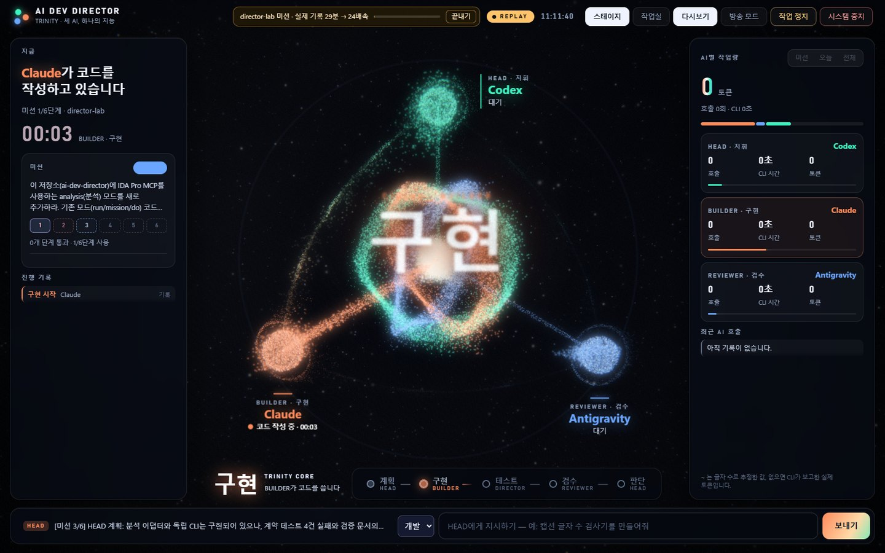
*BUILDER(Claude)가 코드 작성 중. 오른쪽 작업량에 BUILDER 호출 1회·2분·6.9만 토큰이 쌓이기 시작한다.*

BUILDER에게 무엇이 주입됐나 — [`builder_cli.json`](assets/evidence/run1_step1_FAIL/builder_cli.json):
```json
{
  "prompt_chars": 103865,
  "context_files": ["schemas/finding.py", "core/ida_analysis_cli.py", "docs/IDA_ANALYSIS_MVP.md",
                    "agents/ida_analyst.py", "tests/test_ida_analysis.py", "README.md",
                    "agents/__init__.py", "agents/antigravity_builder.py", "agents/claude_analyst.py",
                    "agents/google_roles.py", "agents/head.py", "core/__init__.py",
                    "docs/DASHBOARD_WORKSPACE_V2.md"]
}
```
> **관찰**: 기억이 없으니 매 호출마다 **10만 자**를 다시 넣는다(콜드스타트). 그리고 과제와 무관한 파일(`DASHBOARD_WORKSPACE_V2.md` 등)도 섞여 있다.

시도 기록 [`builder_cli_attempts.json`](assets/evidence/run1_step1_FAIL/builder_cli_attempts.json) — **실패 지점 H1**:
```json
[
  {"provider": "ANTHROPIC", "invocation_command": "claude --print --output-format json", "execution_duration_sec": 141.69,
   "error": "BUILDER_EXCEPTION: Invalid control character at: line 1 column 11155 (char 11154)"},
  {"provider": "ANTHROPIC", "execution_duration_sec": 274.765, "error": null},
  {"provider": "ANTHROPIC", "execution_duration_sec": 89.552,  "error": null},
  {"provider": "ANTHROPIC", "execution_duration_sec": 30.673,
   "error": "BUILDER_EXCEPTION: Invalid control character at: line 1 column 945 (char 944)"},
  {"provider": "ANTHROPIC", "execution_duration_sec": 36.052,  "error": null},
  {"provider": "OPENAI",    "invocation_command": "codex exec --sandbox read-only - <stdin>", "execution_duration_sec": 14.571, "error": null}
]
```
> Claude가 2분 넘게 코드를 써 놓고도, 파일 내용을 담은 **JSON 문자열에 제어문자가 섞여 파싱 실패** → 결과 전체 폐기. 마지막 줄이 failover된 Codex.

### ③ 테스트 — DIRECTOR가 실제로 pytest를 돌린다

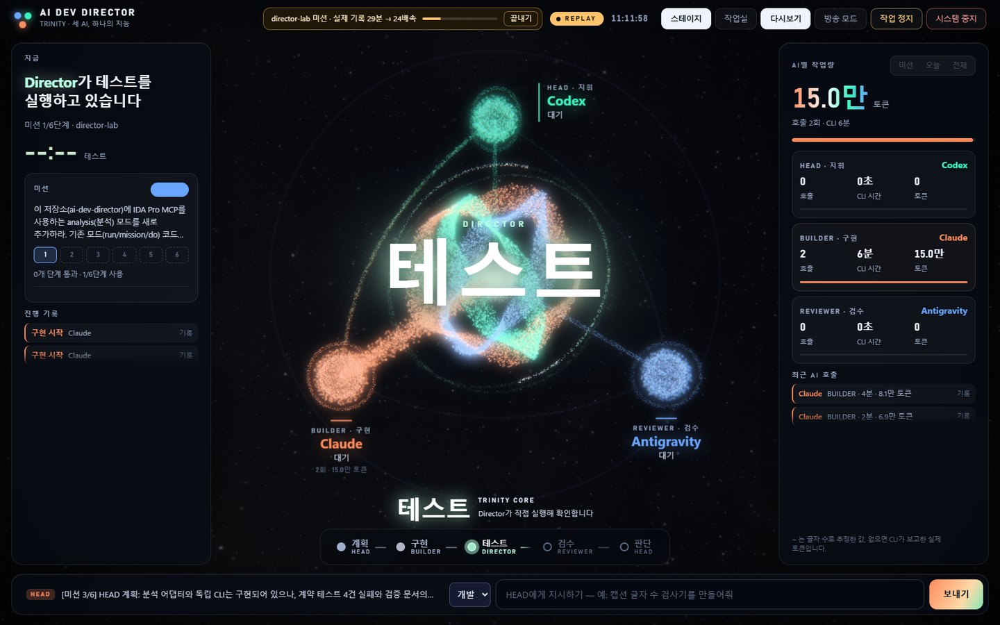
*"Director가 테스트를 실행하고 있습니다" — 이 단계는 AI가 아니라 일반 프로그램(pytest)이 담당하는 그래프의 프로그램 노드.*

[`verification.json`](assets/evidence/run1_step1_FAIL/verification.json) (발췌):
```json
{ "passed": false, "summary": "Test: FAIL",
  "test_counts": {"passed": 123, "failed": 1, "total": 124},
  "preexisting_failures": null,
  "test": {"command": "python -m pytest tests/ -q -k \"analysis or finding or analyst or analyze\""} }
```
```text
FAILED tests/test_v300i_failure_learning_loop.py::test_d_reviewer_findings_land_in_research_memory
1 failed, 123 passed, 602 deselected, 124 warnings in 16.85s
```
> **관찰**: 실패 1건은 이번 과제와 무관한 **기존 테스트**다. 키워드 `finding`이 이름 속 `findings`에 걸려 들어왔다(P1). 기준선에서 이미 감지됐는데도 `preexisting_failures: null` — 관용 처리가 꺼져 있었다(L1).

### ④ 검수 — REVIEWER가 독립적으로 판정한다

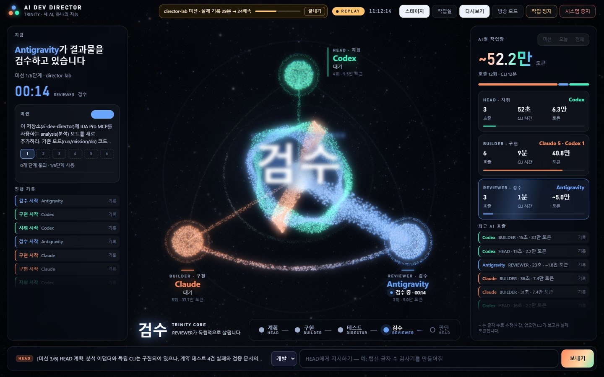
*REVIEWER(Antigravity)가 결과물 검수 중. 진행 표시가 "검수 · REVIEWER".*

REVIEWER → HEAD [`review.json`](assets/evidence/run1_step1_FAIL/review.json):
```json
{ "verdict": "pass", "p0": [], "p1": [], "p2": [],
  "summary": "All acceptance criteria in the ORDER are satisfied within allowed_paths without modifying protected_paths …
              In the supplied verification run (123 passed, 1 failed, 602 deselected), the sole failure is the documented
              pre-existing tests/test_v300i_failure_learning_loop.py::test_d_reviewer_findings_land_in_research_memory
              originating in core/research_prompts.py outside allowed_paths." }
```
> 리뷰어는 실패의 출처까지 정확히 짚고 **통과**시켰다.

### ⑤ 판단 — HEAD가 최종 결정한다

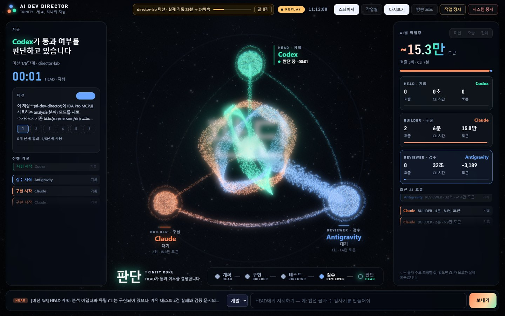
*HEAD(Codex)가 "통과 여부를 판단하고 있습니다". 중앙에 '판단', 진행 표시의 마지막 칸.*

HEAD [`decision.json`](assets/evidence/run1_step1_FAIL/decision.json):
```json
{ "decision": "FAIL",
  "rationale": "Automated verification failed: 123 passed and 1 documented pre-existing failure. Reviewer passed with no findings …
                but strict PASS requires passing build and tests. The reported failure originates outside allowed_paths …;
                resolving this scope conflict requires mission replanning, not a user decision.",
  "next_steps": ["… create a separate baseline-repair order authorizing those files.", "…"] }
```
> **AI 셋 모두 원인을 정확히 알았다.** 그런데도 "엄격한 PASS 규칙" 때문에 FAIL. 문제는 판단력이 아니라 **판정 규칙(게이트)** 이었다.

### ⑥ 수리 루프 + failover — 같은 루프 3번, 결국 다른 AI가 대행

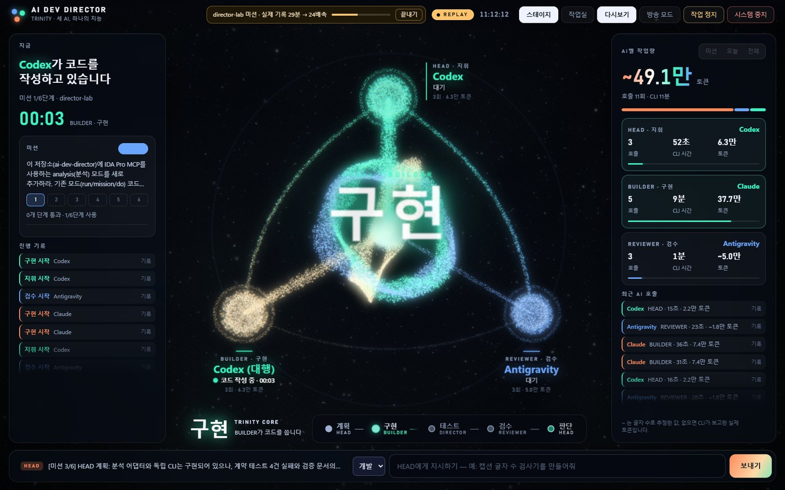
*BUILDER 자리에 **"Codex (대행)"**. 그 시점까지 오른쪽 작업량 BUILDER 칸은 Claude 5회 호출 · 9분 · 37.7만 토큰. Claude가 반복 실패해 Codex가 구현을 대신 맡은 순간.*

[`repair_history.json`](assets/evidence/run1_step1_FAIL/repair_history.json) 요약 (원본에서 집계):

| 수리 회차 | REVIEWER | P0/P1 | HEAD 판단 | 테스트 |
|---|---|---|---|---|
| 1 | pass | 0 / 0 | **FAIL** | 123 통과 / 1 실패 |
| 2 | pass | 0 / 0 | **FAIL** | 123 / 1 |
| 3 (Codex 대행) | pass | 0 / 0 | **FAIL** | 123 / 1 |

Codex(대행)가 돌려준 결과(`builder_cli.json`의 `output`) — **아무것도 바꾸지 않는 게 맞다고 판단**:
```json
{"files": [], "edits": [],
 "summary": "변경 없음. 제공된 소스에 필수 산출물 5개가 모두 존재하며, 리뷰는 통과했다. HEAD의 유일한 미해결 항목은 기존 테스트 … 실패로,
             보고된 원인 core/research_prompts.py는 allowed_paths 밖이다. 현재 ORDER에서는 수정할 수 없다. …"}
```

### ⑦ 종료 — 증거 묶음을 남기고 멈춘다

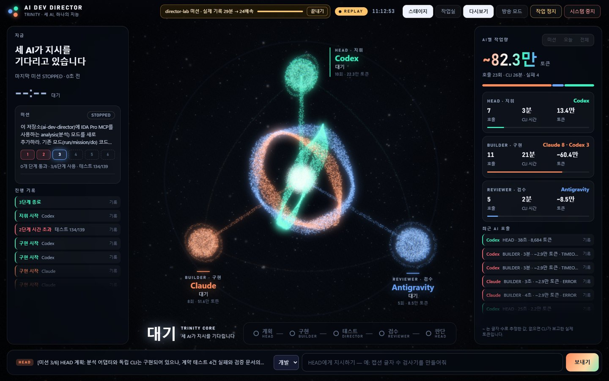
*세 AI 대기, "마지막 미션 STOPPED". 콘솔의 미션 전체 집계: 호출 25회 · CLI 28분 · ~83.4만 토큰(글자 수 추정치) · **실패 4**, BUILDER는 **Claude 8회 · Codex 3회**(대행).*

[`final_evidence.json`](assets/evidence/run1_step1_FAIL/final_evidence.json):
```json
{ "reasons": ["BASELINE_FAILED", "VERIFICATION_FAILED"],
  "order_paths": "PASS", "canonical_containment": "PASS",
  "baseline": "FAIL", "verification": "FAIL",
  "head_decision": "FAIL", "reviewer_verdict": "pass" }
```

---

## 2.5 JSON 흐름 전체 — AI끼리는 직접 대화하지 않는다

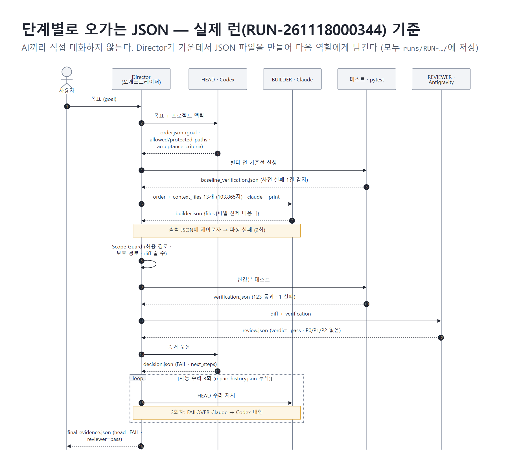

- 오케스트레이션에서 "AI 간 대화"의 실체는 **Director가 가운데서 만드는 JSON 파일**이다. 각 AI는 **앞 AI를 기억하지 못하고**, 매번 Director가 다시 조립한 입력만 본다.
- 그래서 정보가 JSON에 안 담기면 다음 AI는 모른다 — 이것이 그래프의 **'상태'** 이고, 이번 구조의 약점이다.

<a id="ai-chat"></a>
## 2.6 AI 간 대화 내역 — HEAD 대화 로그

AI끼리 주고받은 판단은 HEAD가 사람에게 보고하는 **HEAD 대화** 창에 요약돼 나온다.

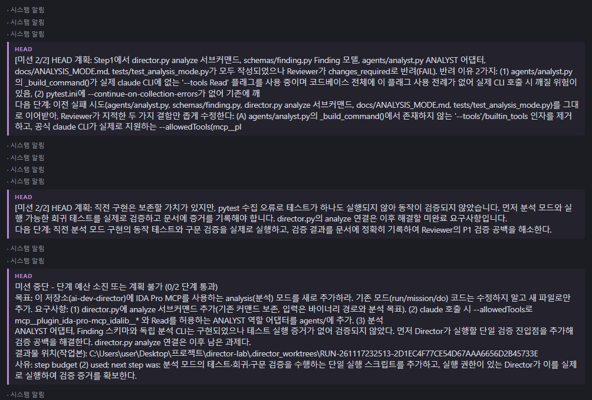
*맨 위: 실험 1의 2단계 계획 — HEAD가 **리뷰어의 반려 사유를 요약해 다음 수리 지시를 내리는** 장면. 반려 이유 ① `agents/analyst.py`가 **실제 claude CLI에 없는 `--tools Read` 플래그**를 사용(환각 → 리뷰어가 적발, 원본: 실험 1 런의 review.json) ② 기존 테스트의 수집 오류로 테스트가 하나도 실행되지 않음. 그 아래: 실험 2의 계획과 "미션 중단 - 단계 예산 소진(0/2 단계 통과)".*

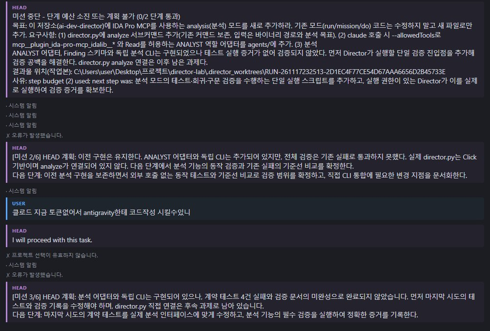
*실험 3: 내가 "클로드 지금 토큰없어서 antigravity한테 코드작성 시킬수있니"라고 보내자 HEAD가 **"I will proceed with this task."** 라고 답했지만, 바로 다음 줄이 **"✗ 프로젝트 선택이 유효하지 않습니다"**, **"✗ 오류가 발생했습니다"**. 영상 도입부의 "다 됐다고 했는데 안 된" 상황의 실물.*

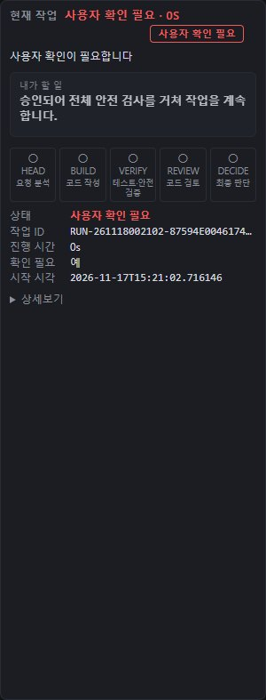
*그 직후 우측 패널: 상태 "사용자 확인 필요", 오류 코드 `PROJECT_SELECTION_REQUIRED`.*

---

## 2.7 각 .py의 동작 원리 — 호출 순서대로

```text
director.py do "<목표>" -p <프로젝트> --profile standard
 └─ core/mission.py         MissionRunner: 미션을 단계로 나누고 단계마다 run 하나를 실행, 결과를 data/missions/*.json에 누적
     └─ core/orchestrator.py  한 run의 상태기계
         ├─ agents/codex_head.py        HEAD 호출 → order.json   (codex exec, stdin으로 프롬프트, stream-json 이벤트 파싱)
         ├─ core/git_manager.py         git worktree 생성 (.director_worktrees/RUN-…) — 원본 격리
         ├─ run_baseline_if_required()  빌더 전 깨끗한 worktree에서 기준선 테스트 → baseline_verification.json
         ├─ core/builder_context.py     BUILDER용 컨텍스트 조립 (참조 파일 모음, 단일 예산)
         ├─ agents/proposal_builder.py  BUILDER 호출 (core/research_runner.py가 provider별 CLI 명령 구성)
         │                               실패 누적 시 provider_manager가 다른 provider로 failover
         ├─ validate_post_build()       ① core/safety.py Scope Guard (허용·보호 경로, diff 줄 수, 제어판 파일)
         │                               ② 돈 이동 코드 탐지 (core/autopilot.py)
         │                               ③ core/verifier.py 테스트 실행 → verification.json
         │                               ④ autopilot.only_preexisting_failures() 기존 실패 관용 (※ 이어받기 런에선 꺼짐)
         ├─ agents/*_reviewer.py / google_roles.py  REVIEWER 호출 → review.json
         ├─ HEAD 판단 → decision.json, 실패면 수리 지시 → repair_history.json 누적 후 BUILDING으로
         └─ core/state_machine.py       상태 전이·감사 로그, run.log
 공통 기반
  core/process_runner.py   ProcessTreeRunner: CLI 프로세스 실행·타임아웃(무출력 180초)·프로세스 트리 정리
  core/env_utils.py        get_sanitized_env(): CLI 호출 전 API 키 환경변수 제거 → 구독 세션만 사용 강제
  core/role_settings.py    역할별 provider 설정 (model='cli-default' → 모델 플래그 미전달)
  companion_server.py / dashboard_server.py   콘솔(8081) 백엔드 — 위 기록을 읽어 화면에 표시, 다시보기 제공
  core/head_sessions.py    (Codex와 추가) 프로젝트별 HEAD 세션 ID를 SQLite에 저장, resume으로 재개
```

| 파일 | 핵심 원리 | 이번 실험에서 드러난 점 |
|---|---|---|
| `core/orchestrator.py` | 상태기계. 각 단계 결과를 JSON으로 저장하고 다음 단계 입력으로 사용 | 이어받기 런에서 기존 실패 관용이 꺼지는 조건(`builds_on_director_work`) → L1 |
| `core/verifier.py` | build·test·lint 명령의 **종료 코드**로 통과 판정, 출력에서 통과/실패 수 파싱 | 종료 코드 2(수집 오류)와 0개 실행을 구분하지 못한 경로 → L4 |
| `core/autopilot.py` | 위반 분류, 기존 실패 관용, HEAD 대리 면제(diff 예산 등) | diff 500줄 초과를 매번 대리 면제 → L2 |
| `core/safety.py` | 경로 기반 강제 차단 (하네스의 출입문) | 정상 작동 — 대행 Codex도 범위를 지킴 |
| `core/builder_context.py` | 참조 파일을 모아 프롬프트로 직렬화 | 대상 파일 누락·무관 파일 포함 → C1, 10만 자 재주입 → C2 |
| `agents/proposal_builder.py` | 결과를 **파일 전체를 담은 JSON**으로 받아 Director가 기록 | 큰 출력에서 JSON 깨짐 → H1 |
| `core/process_runner.py` | 무출력 타임아웃으로 멈춘 CLI 정리 | Codex 대행이 180초 무출력 → L3 |

## 2.8 정리

- 화면의 [계획→구현→테스트→검수→판단]은 **실제 상태 전이와 1:1로 대응**했고, 각 단계의 입출력은 **JSON 파일로 전부 남아 있었다** → 구조 자체는 투명하고 잘 설계됨.
- 그러나 같은 루프를 4번 돌며 **리뷰어 pass / HEAD FAIL**이 반복됐다. 원인은 AI의 판단력이 아니라 **판정 규칙과 출력 형식**이었다.
- AI 간 "대화"는 JSON 파일 전달일 뿐이고, 각 AI는 서로를 기억하지 못한다 — 이 구조적 특성이 3장의 실패 다수와 4장 TO-BE의 출발점이다.

[← 1. 5단계 구조](01_AI에게_일시키는_구조_5단계.md) · [목차](README.md) · [다음: 3. 실험과 실패 지점 →](03_실험기록과_실패지점.md)
