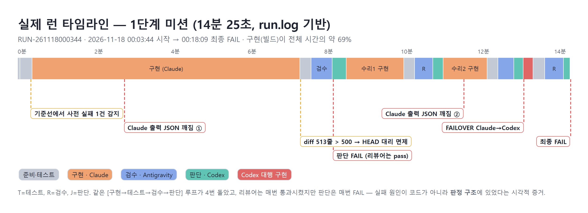
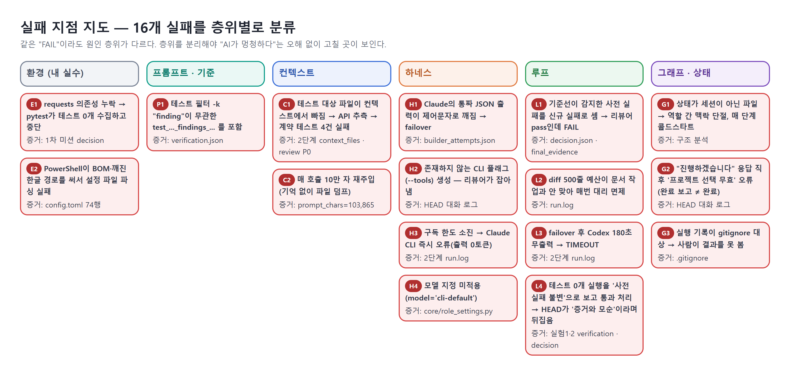
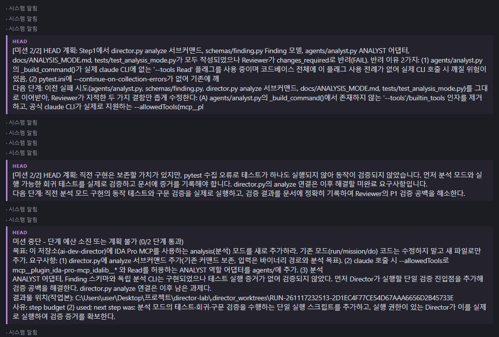
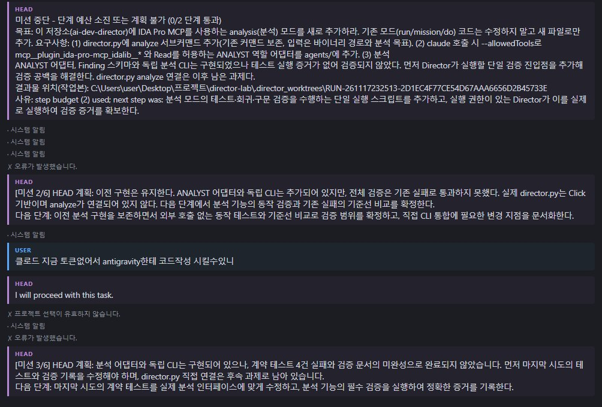

# 3. 실험 기록과 실패 지점 — 16개 실패를 층위별로

> 같은 "FAIL"이라도 원인 층위가 다르다. 처음엔 "AI가 자꾸 실패한다 = AI가 멍청하다"로 느꼈지만,
> 기록을 하나씩 열어 보니 **대부분은 환경(내 실수)·판정 규칙·출력 형식·상태 전달**의 문제였다.
> 이 장은 실험 순서대로 무엇을 했는지 정리하고, 실패 16개를 **증상 → 증거 → 원인 → 교훈** 으로 분해한다.

[← 2. 실제 동작 증적](02_오케스트레이션_실제동작_증적.md) · [목차](README.md) · [다음: 4. AS-IS → TO-BE 리포트 →](04_AS-IS_TO-BE_리포트.md)

---

## 3.1 실험 개요

**공통 과제(도그푸딩)**: director에게 director 자신을 고치게 한다 — "IDA Pro MCP를 쓰는 analysis(분석) 모드를 새 파일로만 추가하라."
역할: HEAD=Codex · BUILDER=Claude · REVIEWER=Antigravity · 대상 저장소=`Desktop/프로젝트/director-lab` (director 복사본)

| | 준비 | 실험 1 | 실험 2 | (환경 수정) | 실험 3 |
|---|---|---|---|---|---|
| **미션** | — | `MSN-…225246` | `MSN-…232513` | — | `MSN-…000344` |
| **프로파일** | — | quick (2단계) | quick (2단계) | — | standard (6단계) |
| **시간** | 11-17 | 22:52 ~ 23:10 | 23:25 ~ 23:35 | 23:40경 | 11-18 00:03 ~ 00:32 |
| **한 일** | IDA MCP 연결(`hostname.exe` 디컴파일 성공), MENTOR 구축, 모델 배정 | 1단계 FAIL → 2단계 계획 후 내가 정지 | 1단계 FAIL → 예산 소진 INCOMPLETE | `requests` 설치, 설정 파일 BOM·모지바케 제거, 테스트 명령을 analysis 관련으로 한정(`-k`) | 1단계 FAIL(14분) → 2단계 TIMEOUT → 3단계 계획 후 정지 |
| **주요 실패** | E2 | E1 · H2 · L4 | E1 · L4 | — | P1 · L1 · H1 · L2 · C1 · C2 · H3 · L3 · G2 |
| **결과물** | — | — | 6개 파일 생성 — `requests` 설치 후 직접 돌려보니 **56개 테스트 전부 통과** → [`../analysis-mode/`](../analysis-mode/)로 회수 | — | 5개 파일 생성, 리뷰어 pass |

> 실험 2의 결과물이 "FAIL" 판정을 받았지만 **실제로는 동작하는 코드**였다는 게 이 장 전체의 출발점이다.

## 3.2 실험 3 타임라인



- 전체 14분 25초 중 **구현(빌드)이 약 69%**. 그 안에서 Claude가 두 번 2분 넘게 코드를 쓰고도 출력 JSON이 깨져 결과가 버려졌다.
- 같은 [구현→테스트→검수→판단] 루프가 4번 돌았고, **리뷰어는 4번 모두 pass(P0/P1 0건), HEAD는 4번 모두 FAIL**, 테스트는 4번 모두 123 통과 / 1 실패 — 원본 [`repair_history.json`](assets/evidence/run1_step1_FAIL/repair_history.json)

## 3.3 실패 지점 지도



| 층위 (영상의 단계) | 실패 ID | 개수 |
|---|---|---|
| 환경 — 내 실수 | E1 · E2 | 2 |
| 프롬프트·기준 | P1 | 1 |
| 컨텍스트 | C1 · C2 | 2 |
| 하네스 | H1 · H2 · H3 · H4 | 4 |
| 루프 | L1 · L2 · L3 · L4 | 4 |
| 그래프·상태 | G1 · G2 · G3 | 3 |

---

## 3.4 실패 상세

<a id="e1"></a>
### E1. 의존성 누락 → 테스트가 0개 실행 (환경 · 내 실수)
- **증상**: 실험 1·2에서 테스트 결과가 `passed 0, failed 0, total 0`, 종료 코드 2.
- **증거**: 실험 1 런의 HEAD 판단 — *"raw pytest output shows 'Interrupted: 1 error during collection' from the pre-existing tests/test_v020_provider_ops.py ModuleNotFoundError('requests')"*
- **원인**: director 자체 테스트 하나가 `requests`를 import하는데 내가 의존성을 일부만 설치했다. pytest는 수집 단계에서 하나만 실패해도 **전체를 중단**한다.
- **교훈 → [T1](04_AS-IS_TO-BE_리포트.md#tasks)**: 검증 러너 환경은 requirements 전체로 맞추고, 시작 전에 "테스트가 실제로 수집되는지" 자체 점검.

<a id="e2"></a>
### E2. 설정 파일 인코딩 깨짐 (환경 · 내 실수)
- **증상**: Codex CLI가 시작조차 못 함.
- **증거**:
  ```text
  Codex CLI exited with code 1: Error loading config.toml:
  C:\Users\user\.codex\config.toml:74:40: unclosed table, expected `]`
  74 | [projects.'c:\users\user\desktop\?ㅽ뵾而?]
  ```
- **원인**: PowerShell `Set-Content -Encoding UTF8`이 **UTF-8 BOM**을 붙였고, 한글 경로가 든 테이블 키가 깨졌다(모지바케).
- **교훈 → T1**: Windows에서 TOML/YAML/JSON은 BOM 없는 쓰기(파이썬·전용 편집기). 한글 경로를 설정 키로 쓰지 않기.

<a id="p1"></a>
### P1. 테스트 키워드 필터가 무관한 테스트를 포함 (프롬프트·기준)
- **증상**: analysis 관련만 돌리려고 `-k "analysis or finding or analyst or analyze"`를 줬는데 무관한 테스트 1건이 실패로 잡힘.
- **증거**: [`verification.json`](assets/evidence/run1_step1_FAIL/verification.json) — `FAILED tests/test_v300i_failure_learning_loop.py::test_d_reviewer_`**`findings`**`_land_in_research_memory` · `1 failed, 123 passed, 602 deselected`
- **원인**: `-k`는 **부분 문자열** 매칭이라 `findings`가 `finding`에 걸렸다. 성공 기준을 내가 부정확하게 정의한 것.
- **교훈 → T2**: 테스트 범위는 키워드가 아니라 **파일 경로**로 지정. (영상 루프 1질문 "무엇이 성공인가"를 정확히)

<a id="c1"></a>
### C1. 테스트 대상 파일이 컨텍스트에서 빠짐 → 추측으로 테스트 작성 (컨텍스트)
- **증상**: 실험 3의 2단계에서 BUILDER가 쓴 계약 테스트 4건이 실패(134 통과 / 5 실패).
- **증거**: 2단계 [`builder_cli.json`](assets/evidence/run2_step2_TIMEOUT/builder_cli.json)의 주입 파일 목록에 **테스트 대상인 `agents/ida_analyst.py`가 없다**:
  ```json
  "context_files": ["docs/IDA_ANALYSIS_VERIFICATION.md", "tests/test_ida_analysis_contract.py", "README.md",
                    "agents/__init__.py", "agents/antigravity_builder.py", "agents/claude_analyst.py",
                    "agents/google_roles.py", "agents/head.py", "core/__init__.py", "docs/DASHBOARD_WORKSPACE_V2.md"]
  ```
  리뷰어 P0 ([`review.json`](assets/evidence/run2_step2_TIMEOUT/review.json)): *"…fail at _analyst_error() with AssertionError: agents.ida_analyst exposes no analyst error among ('AnalystError', 'AnalysisError')."*
- **원인**: 컨텍스트 조립이 파일을 기계적으로 고르면서 정작 필요한 파일을 놓쳤다. BUILDER는 **본 적 없는 클래스의 예외 이름을 추측**했다 (0장 0.1 "입력에 없는 건 모른다").
- **교훈 → T5**: 대상 파일은 필수 포함 규칙으로. 근본적으로는 에이전트가 세션 안에서 직접 `Read`/`Grep`으로 찾게 한다.

<a id="c2"></a>
### C2. 매 호출 10만 자 재주입 (컨텍스트)
- **증거**: `"prompt_chars": 103865` (1단계 BUILDER 호출 한 번).
- **원인**: 기억(세션)이 없으므로 필요한 모든 것을 매번 다시 넣어야 한다. 비싸고, 길수록 주의가 흐려진다.
- **교훈 → T3**: 세션 유지 + 변경분만 전달.

<a id="h1"></a>
### H1. 통짜 JSON 출력이 깨짐 → failover → 맥락 소실 (하네스)
- **증거**: [`builder_attempts.json`](assets/evidence/run1_step1_FAIL/builder_attempts.json)
  ```json
  [{"attempt": 1, "provider": "ANTHROPIC", "error": "BUILDER_EXCEPTION: Invalid control character at: line 1 column 11155 (char 11154)"},
   {"attempt": 1, "provider": "ANTHROPIC", "error": "BUILDER_EXCEPTION: Invalid control character at: line 1 column 945 (char 944)"}]
  ```
  화면: [2장 ⑥ failover 캡처](02_오케스트레이션_실제동작_증적.md) — BUILDER 자리에 "Codex (대행)".
- **원인**: BUILDER가 **여러 파일의 전체 내용을 JSON 문자열 하나**에 담아 반환하는 방식. 출력이 커지면 제어문자 하나로 전체가 파싱 불가 → 2분 넘게 쓴 결과 폐기 → 반복 실패 시 다른 AI로 대행 → 앞 AI의 맥락은 전달되지 않음.
- **교훈 → T4**: 결과물은 **도구로 파일을 직접 수정**하고, 산출물은 `git diff`로 확인.

<a id="h2"></a>
### H2. 존재하지 않는 CLI 플래그 생성 (하네스 · 환각) — 리뷰어가 적발 ✅
- **증거**: 실험 1 런의 리뷰어 P0 — *"agents/analyst.py's entire security rationale rests on a `--tools Read` CLI flag … This flag appears nowhere else in the codebase"*. 화면: 
- **원인**: 모델이 그럴듯한 플래그를 지어냈다(0장 0.1). **AI 코드 품질 자체가 원인인 몇 안 되는 실패** — 그리고 독립 검수가 정확히 잡아냈다.
- **교훈**: 독립 검수자는 유지할 가치가 있다 → TO-BE에서 REVIEWER는 **신선한 세션**으로 유지.

<a id="h3"></a>
### H3. 구독 한도 소진 추정 → CLI 즉시 오류 (하네스)
- **증거**: 2단계 [`run.log`](assets/evidence/run2_step2_TIMEOUT/run.log)
  ```text
  00:26:25 Builder attempt 1/3 on ANTHROPIC failed: ANTHROPIC CLI exit 1: {"is_error":true,"duration_api_ms":0, … "output_tokens":0 …}
  00:26:29 Builder attempt 2/3 on ANTHROPIC failed: (같은 오류)
  00:26:29 [FAILOVER] BUILDING: BUILDER ANTHROPIC -> OPENAI
  ```
- **원인(추정)**: API 처리 시간 0ms·출력 0토큰으로 4초 만에 종료. 같은 시각 내가 콘솔에 "클로드 지금 토큰없어서…"라고 보낸 것과 일치 → 구독 사용 한도 소진으로 판단.
- **교훈 → T8**: 한도 소진은 "재시도·대행"이 아니라 **중단하고 사람에게 보고**할 사건.

<a id="h4"></a>
### H4. 모델 지정이 실제로 적용되지 않음 (하네스)
- **증거**: `core/role_settings.py` — `update(provider=provider, executable=None, model='cli-default')`. 실제 호출 명령에 `--model` 없음 (`codex exec --sandbox read-only -`, `claude --print --output-format json`).
- **원인**: director는 모델 선택을 각 CLI 계정 기본값에 맡긴다. 설정 파일의 모델 값은 강제되지 않는다. (`--model`은 내가 패치한 agy 경로에만 존재)
- **교훈 → T7**: 역할별 모델은 하네스에서 명시적으로 강제하고, 실제 호출 기록으로 확인.

<a id="l1"></a>
### L1. 기준선이 감지한 기존 실패를 신규 실패로 셈 (루프 · 성공 기준)
- **증거**: 기준선 단계 로그 `BASELINE_PREEXISTING_FAILURES: … test_d_reviewer_findings_land_in_research_memory` → 그런데 검증 결과 `"preexisting_failures": null`, HEAD *"strict PASS requires passing build and tests"* → FAIL. [`final_evidence.json`](assets/evidence/run1_step1_FAIL/final_evidence.json): `head_decision: FAIL, reviewer_verdict: pass`
- **원인(코드)**: `core/orchestrator.py`의 `builds_on_director_work`(이전 작업본을 이어받는 런) 조건이 참이면 기존 실패 관용(`only_preexisting_failures`)이 **통째로 꺼진다**. "이전 마일스톤이 만든 실패는 고쳐야 한다"는 의도지만, 이번 실패는 원본 저장소에 원래 있던 것이었다.
- **교훈 → T2**: 기존 실패는 **명시 목록(known_failures)** 으로 관리하고 판정에 반영.

<a id="l2"></a>
### L2. diff 줄 수 예산이 과제와 안 맞아 매번 대리 면제 (루프)
- **증거**: `[HEAD proxy] waived on the user's behalf: Max diff lines exceeded: 513 > 500` (1단계), `512 > 500` (2단계). HEAD는 별도로 "13줄 줄여라"는 수리 지시까지 냄.
- **원인**: 문서·테스트를 같이 쓰는 과제에서 500줄 제한은 빡빡하다. 규칙과 면제가 동시에 작동하며 수리 루프만 늘렸다.
- **교훈**: 예산은 과제 유형별로. 무의미한 규칙은 루프 비용만 늘린다.

<a id="l3"></a>
### L3. 대행 Codex가 180초 무출력 → TIMEOUT (루프)
- **증거**: `00:32:32 Builder attempt 3/3 on OPENAI failed (TIMEOUT): NO_OUTPUT_TIMEOUT: No output for 180s` → `Builder failed after 3 attempt(s) across ANTHROPIC, OPENAI`
- **원인**: 맥락 없이 대행에 들어간 Codex가 6분간 결과를 못 냈다. 대행은 실패를 늦출 뿐 해결하지 못했다.
- **교훈 → T8**: 대행은 제한적으로, 타임아웃 시 사람에게 보고.

<a id="l4"></a>
### L4. 테스트 0개 실행을 '통과'로 판정 — AI가 뒤집음 (루프 · 성공 기준)
- **증거**: 실험 1·2 검증 요약 `Test: FAIL; PRE-EXISTING FAILURES UNCHANGED (no new failures): tests/test_v020_provider_ops.py` (counts 0/0/0, exit 2) → 게이트가 통과로 처리. 실험 2 HEAD: *"Pytest exited 2 during collection with zero tests executed … verification.passed=true therefore contradicts the evidence"*
- **원인**: 기존 실패 관용이 "수집 오류로 아무것도 안 돈 상황"까지 '불변'으로 봤다. L1과 정반대 방향의 오류.
- **교훈 → T2**: 판정 게이트는 **양방향으로 틀릴 수 있다**. "실행된 테스트 수 > 0"을 필수 조건으로. 그리고 AI 판정자(HEAD·리뷰어)가 규칙의 모순을 잡아낸 점은 기록해 둘 가치가 있다.

<a id="g1"></a>
### G1. 상태가 세션이 아니라 파일 — 매 단계 콜드스타트 (그래프·상태)
- **증거**: 2장 2.1 — 모든 역할이 1회성 호출. C2의 10만 자 재주입, H1의 대행 시 맥락 소실, C1의 파일 선택 실수가 모두 이 구조에서 나온다.
- **원인**: 그래프의 '상태'(영상 1.5)를 대화 세션이 아니라 Director가 다시 조립하는 JSON·파일로만 넘겼다.
- **교훈 → T3·T6**: 세션 유지 + 사람이 읽는 프로젝트 기억 파일. (4장의 핵심)

<a id="g2"></a>
### G2. "진행하겠습니다" 직후 오류 — 완료 보고 ≠ 완료 (그래프·상태)
- **증거**: 
- **원인**: HEAD는 대화 응답만 생성했고 실제 실행은 프로젝트 선택 상태 검사에서 막혔다. AI의 말과 시스템 상태가 분리돼 있다.
- **교훈 → T10**: 영상의 ERP 사례처럼 **"사람이 확인해야 완료"** 인 노드를 그래프에 둔다.

<a id="g3"></a>
### G3. 실행 기록이 공유 불가 (그래프·상태 · 가시화)
- **증거**: director의 `.gitignore` — `data/*`, `runs/`, `.director_worktrees/` (주석: *runtime state is never source*). 콘솔엔 성공/실패 요약만.
- **원인**: 기록은 자세했지만 엔진 폴더 안의 생 JSON이었고, 결과 코드는 숨김 worktree에 남았다. 그래서 처음엔 무엇이 왜 실패했는지 몰랐다.
- **교훈 → T9**: `tools/harvest.py`(사람용 REPORT + git), `tools/watch_live.py`(실시간 관전)를 만들었다 — 이 문서의 증거도 그 덕분에 모을 수 있었다.

---

## 3.5 정리 — 원인을 분리하면 보이는 것

| 구분 | 해당 실패 | 비율 |
|---|---|---|
| AI 코드 품질 자체 | H2 (환각 플래그) — **리뷰어가 잡음** | 1 / 16 |
| AI가 못 본 것 때문 (컨텍스트) | C1 — 추측으로 쓴 테스트 | 1 / 16 |
| 판정·규칙 | P1 · L1 · L2 · L4 | 4 / 16 |
| 출력 형식·실행 환경·한도 | H1 · H3 · H4 · L3 | 4 / 16 |
| 구조(상태·가시성) | C2 · G1 · G2 · G3 | 4 / 16 |
| 내 환경 실수 | E1 · E2 | 2 / 16 |

> **결론**: "AI가 자꾸 실패한다"의 실체는 **AI 바깥 구조의 실패**였다. 16개 중 AI 코드 자체의 문제는 1개였고, 그것도 독립 검수가 잡았다.
> 영상의 결론 — *AI를 더 똑똑하게가 아니라 일할 시스템을 만들어라* — 를 실험으로 확인한 셈이다.

[← 2. 실제 동작 증적](02_오케스트레이션_실제동작_증적.md) · [목차](README.md) · [다음: 4. AS-IS → TO-BE 리포트 →](04_AS-IS_TO-BE_리포트.md)
