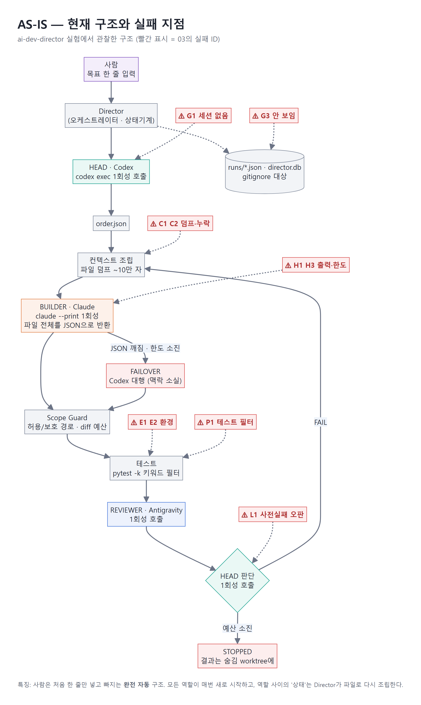
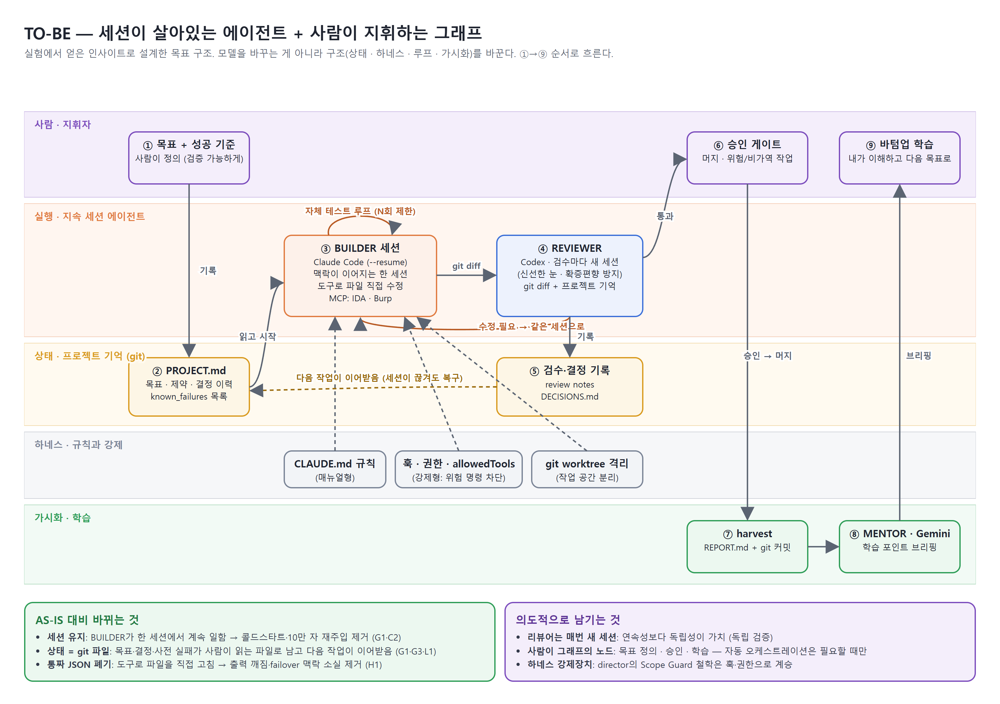
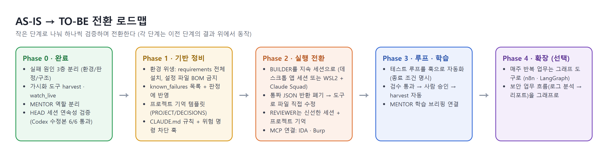

# 4. AI 오케스트레이션 구조 개선 리포트 — AS-IS 진단과 TO-BE 설계

| 항목 | 내용 |
|---|---|
| 문서 성격 | 실험 기반 구조 진단 및 개선 설계 리포트 |
| 근거 자료 | 실험 3회(미션 3개, 주요 런 4개)의 원본 기록, 콘솔 화면 캡처, 코드 분석 — [2장](02_오케스트레이션_실제동작_증적.md) · [3장](03_실험기록과_실패지점.md) |
| 기준 개념 | 프롬프트 → 컨텍스트 → 하네스 → 루프 → 그래프 ([1장](01_AI에게_일시키는_구조_5단계.md)) |
| 작성 | 2026-11-18 |

[← 3. 실험과 실패 지점](03_실험기록과_실패지점.md) · [목차](README.md) · [다음: 5. 도구 비교 →](05_AI툴비교와_TO-BE.md)

---

## 1. 요약

1. 구독 CLI 기반 오케스트레이터(`ai-dev-director`)로 실제 개발 과제를 3회 수행했다. 결과는 모두 FAIL/중단이었지만, **산출 코드는 동작했고(56개 테스트 통과) 독립 리뷰어는 4회 연속 통과**시켰다.
2. 실패 16건을 층위별로 분해한 결과 **AI 코드 품질 자체가 원인인 것은 1건**이며 그마저 리뷰어가 적발했다. 나머지는 **판정 규칙, 출력 형식, 상태(기억) 전달, 실행 환경**의 문제였다.
3. 근본 원인은 그래프의 **'상태'를 세션이 아닌 파일 재조립으로 처리**한 데 있다. 모든 역할이 매 단계 콜드스타트하며 10만 자를 다시 주입받고, 대행이 일어나면 맥락이 사라진다.
4. TO-BE는 **"세션이 살아있는 에이전트 + 사람이 지휘하는 그래프 + git에 남는 프로젝트 기억"** 이다. director의 강점(구조화된 지시, 강제장치, 독립 검수, 증거 기록)은 계승하고, 상태·출력·판정·가시성을 바꾼다.
5. 전환은 4단계 로드맵으로 진행하며, Phase 0(가시화 도구, 실패 분석, HEAD 세션 연속성 검증)은 완료했다.

## 2. 배경 및 목적

- **배경**: 앱에서 대화로만 쓰던 AI를 CLI로 여러 개 엮어(Claude가 개발, Codex가 검수) 보안 도구 개발·분석 업무에 쓰고 싶었다. 오픈소스 오케스트레이터를 도입해 직접 돌려 보니 "실패율이 높고, 갈수록 바보가 되는 느낌"이 들었다.
- **목적**: ① 실패가 AI의 능력 문제인지 구조 문제인지 **증거로 판별**한다. ② 내 용도(Windows · 구독 · 보안 도구 MCP · 바텀업 학습)에 맞는 **목표 구조를 설계**한다.
- **범위**: 개발 과제 오케스트레이션. 반복 업무 자동화(그래프 도구)는 확장 단계로 둔다.

## 3. AS-IS 진단

**구조 특징**: 사람은 목표 한 줄만 넣고 빠지는 **완전 자동** 구조. Director가 상태기계로 HEAD → BUILDER → 테스트 → REVIEWER → HEAD를 돌리고, 모든 역할은 **1회성 헤드리스 호출**이다. 역할 사이의 정보는 Director가 JSON·파일로 다시 조립해 전달한다.

| 진단 축 (1장 5단계) | 상태 | 판단 근거 |
|---|---|---|
| 프롬프트 — 지시의 구체성 | ✅ 양호 | ORDER의 인수 기준이 검증 가능한 문장으로 작성됨 |
| 컨텍스트 — 필요한 정보 전달 | ❌ 미흡 | 매 호출 10만 자 덤프(C2), 대상 파일 누락(C1) |
| 하네스 — 환경·강제장치 | ⚠️ 부분 | Scope Guard·키 제거·샌드박스 우수 / 출력 형식 취약(H1), 모델 지정 미적용(H4), 한도 처리 없음(H3) |
| 루프 — 기준·검증자·종료 | ⚠️ 부분 | 검증자·종료조건 우수 / **성공 기준이 양방향으로 오판**(L1·L4), 예산 부적합(L2) |
| 그래프 — 노드·엣지·상태 | ❌ 상태 결함 | 노드·엣지 우수 / 상태가 세션이 아님(G1), 결과가 안 보임(G3), 완료 보고와 실제 불일치(G2) |

## 4. 핵심 인사이트

| # | 인사이트 | 근거 |
|---|---|---|
| **I1** | **실패의 대부분은 코드가 아니라 '바깥 구조' 문제다.** 리뷰어 4회 pass · HEAD 4회 FAIL · 테스트 123/1 고정. 16건 중 AI 코드 자체 문제는 1건. | [repair_history](assets/evidence/run1_step1_FAIL/repair_history.json), [3장 3.5](03_실험기록과_실패지점.md) |
| **I2** | **그래프의 '상태'를 세션 없이 파일로만 넘기면, 매 단계 콜드스타트가 된다.** 10만 자 재주입, 파일 선택 실수, 대행 시 맥락 소실이 모두 여기서 파생된다. | C1·C2·H1·G1, [0장 0.3](00_AI_작동원리.md) |
| **I3** | **출력 형식도 하네스의 일부다.** 여러 파일을 JSON 문자열 하나로 반환받는 방식은 큰 출력에서 깨진다. 에이전트가 도구로 파일을 직접 고치고 결과를 `git diff`로 보는 게 맞다. | H1 — 2분 넘게 쓴 결과가 제어문자 하나로 폐기 |
| **I4** | **독립 검수는 확실한 가치가 있다 — 단, 연속성보다 독립성이 핵심.** 환각 플래그(`--tools`), 추측으로 쓴 테스트, 게이트의 거짓 통과를 AI 판정자가 잡았다. | H2 · C1 · L4 |
| **I5** | **판정 게이트는 양방향으로 틀린다.** 테스트 0개를 통과시키기도, 무관한 기존 실패로 떨어뜨리기도 했다. 기준은 "실행 수 > 0", "기존 실패는 명시 목록"처럼 명확해야 한다. | L1 · L4 · P1 |
| **I6** | **강제장치(하네스의 출입문)는 잘 작동했고 계승할 자산이다.** 대행 AI도 허용 경로 밖은 손대지 않았다. | [1장 1.3](01_AI에게_일시키는_구조_5단계.md) |
| **I7** | **보이지 않으면 원인을 오판한다.** 처음엔 "AI가 멍청하다"고 느꼈지만, 기록을 사람이 읽을 수 있게 만들자 원인이 분리됐다. | G3 · harvest/watch_live 도입 후 분석 가능 |
| **I8** | **"다 됐습니다" ≠ 완료.** AI의 말과 시스템 상태는 분리돼 있다. 사람이 확인해야 완료되는 노드가 필요하다. | G2 |
| **I9** | **목적에 따라 맞는 자동화 수준이 다르다.** 완전 자동은 과정을 숨기므로 탐색·학습·큰 변경에는 사람이 지휘하는 형태가 맞고, 자동 오케스트레이션은 기준이 명확한 작은 반복 작업에서 가치가 있다. 필요 없는 자동화는 유지 비용이 된다. | 3장 전반 · [README 활용 방안](../README.md#5-활용-방안--멀티-에이전트-구조는-어떤-형태로-쓰는-게-좋은가) |

## 5. 해결 과제

| ID | 과제 | 해결 대상 | 해결 방법 | 우선순위 |
|---|---|---|---|---|
| **T1** | 환경 위생 | E1 · E2 | requirements 전체 설치 스크립트, 설정 파일은 BOM 없이 쓰기, 시작 전 "테스트 수집 > 0" 자체 점검 | 높음 |
| **T2** | 성공 기준 정비 | P1 · L1 · L4 | `known_failures` 명시 목록, 실행 테스트 수 > 0 필수, 테스트 범위는 키워드 대신 파일 경로 | 높음 |
| **T3** | 지속 세션 | G1 · C2 | BUILDER를 하나의 세션으로 유지(`--resume`), 변경분만 전달 | **최상** |
| **T4** | 출력 방식 전환 | H1 | 통짜 JSON 반환 폐기 → 도구로 파일 직접 수정, 산출물은 `git diff` | **최상** |
| **T5** | 컨텍스트 정확도 | C1 | 대상 파일 필수 포함, 에이전트가 세션 안에서 직접 탐색 | 높음 |
| **T6** | 프로젝트 기억 | G1 · G3 | `PROJECT.md`(목표·제약), `DECISIONS.md`(결정 로그), review notes — git 관리 | 높음 |
| **T7** | 하네스 강화 | H2 · H4 | `CLAUDE.md` 규칙, 위험 명령 차단·테스트 자동 실행 훅, 역할별 모델 명시 | 중간 |
| **T8** | 한도·대행 정책 | H3 · L3 | 한도 소진·타임아웃은 대행이 아니라 **중단 후 보고** | 중간 |
| **T9** | 가시화·학습 | G3 | harvest(REPORT.md + git), MENTOR 학습 브리핑 | 중간 (일부 완료) |
| **T10** | 완료 확인 노드 | G2 | 머지·위험 작업 전 **사람 승인 게이트** | 중간 |

## 6. TO-BE 구조

### 6.1 레이어 설명

| 레이어 | 구성 | 역할 | 해결 과제 |
|---|---|---|---|
| **사람** (그래프의 사람 노드) | 목표·성공 기준 정의, 승인 게이트, 학습 | 방향과 최종 판단. 자동화는 필요한 곳에만 | T10 · I9 |
| **실행** (지속 세션 에이전트) | BUILDER = Claude Code 한 세션(`--resume`, MCP: IDA·Burp) / REVIEWER = Codex 검수마다 새 세션 / MENTOR = Gemini | BUILDER는 맥락을 이어가며 도구로 직접 수정, REVIEWER는 신선한 눈으로 검수 | T3 · T4 · T5 |
| **상태** (프로젝트 기억, git) | `PROJECT.md`, `DECISIONS.md`, `known_failures`, review notes | 세션이 끊기거나 AI가 바뀌어도 이어받을 수 있는 사람이 읽는 기록 = 그래프의 '상태' | T2 · T6 |
| **하네스** | `CLAUDE.md`/`AGENTS.md` 규칙, 훅·권한·allowedTools, git worktree | 매뉴얼형 규칙 + 강제형 차단 (director의 Scope Guard 철학 계승) | T7 |
| **가시화·학습** | harvest → REPORT.md + git, MENTOR 브리핑 | 무엇을 왜 만들었는지 남기고 배운다 | T9 |

### 6.2 흐름 (①→⑨)

1. **① 목표 + 성공 기준** — 사람이 검증 가능한 기준으로 정의 ("analysis 모드 테스트 파일 X가 통과", "기존 실패는 known_failures 제외").
2. **② PROJECT.md 기록** — 목표·제약·기존 실패 목록을 git에 남긴다.
3. **③ BUILDER 세션** — Claude Code가 PROJECT.md를 읽고 시작. 필요한 파일은 직접 `Read`/`Grep`으로 찾고, 도구로 파일을 고치고, **같은 세션 안에서** 테스트 → 수정을 N회 제한으로 반복.
4. **④ REVIEWER** — Codex가 새 세션으로 `git diff`와 프로젝트 기억만 보고 독립 검수. 수정이 필요하면 의견을 ③의 **같은 BUILDER 세션**으로 돌려보낸다(맥락 유지).
5. **⑤ 기록** — 검수 의견과 결정을 review notes · DECISIONS.md에 남긴다. 다음 작업은 여기서 이어받는다.
6. **⑥ 승인 게이트** — 사람이 머지·위험 작업을 확인.
7. **⑦ harvest** — REPORT.md 생성, git 커밋.
8. **⑧ MENTOR** — 이번 작업의 학습 포인트 브리핑.
9. **⑨ 바텀업 학습** — 내가 이해하고 다음 목표를 정한다.

### 6.3 시나리오 — 같은 과제를 TO-BE로 하면

> 과제: "IDA MCP로 바이너리를 분석하는 ANALYST 어댑터와 테스트 추가"

| 단계 | AS-IS에서 실제로 일어난 일 | TO-BE에서는 |
|---|---|---|
| 시작 | HEAD가 ORDER를 쓰고 Director가 파일 13개(10만 자)를 골라 BUILDER에 주입 | BUILDER 세션이 PROJECT.md를 읽고 필요한 파일을 **직접 열어 봄** |
| 구현 | 파일 전체를 JSON으로 반환 → 제어문자로 2번 폐기 (H1) | 도구로 파일을 직접 생성·수정 — 폐기될 출력이 없음 |
| 테스트 | `-k` 필터에 무관한 테스트가 걸려 FAIL (P1·L1) | 테스트 파일 경로 지정 + known_failures 제외 |
| 대상 파일 | 다음 단계에서 대상 파일을 못 보고 예외 이름 추측 (C1) | 같은 세션이 직전에 자기가 쓴 코드를 기억 |
| 한도 소진 | Codex로 대행 → 180초 무출력 TIMEOUT (H3·L3) | 중단하고 사람에게 보고, 한도 회복 후 **같은 세션 재개** |
| 결과 확인 | 숨김 worktree, 콘솔엔 FAIL만 (G3) | git diff + REPORT.md + 승인 게이트 |

## 7. AS-IS vs TO-BE

| 항목 | AS-IS (director) | TO-BE |
|---|---|---|
| 사람의 위치 | 시작 한 줄 후 빠짐 (완전 자동) | 그래프의 노드 — 기준 정의·승인·학습 |
| 에이전트 기억 | 없음, 매 단계 콜드스타트 | BUILDER 세션 유지, REVIEWER는 의도적으로 신선 |
| 상태 전달 | Director가 JSON·파일을 매번 재조립 | git의 프로젝트 기억 파일 + 세션 |
| 산출물 전달 | 파일 전체를 JSON 문자열로 반환 | 도구로 직접 수정, `git diff` |
| 성공 기준 | 종료 코드 기반, 기존 실패 처리 불안정 | 실행 수 > 0 + known_failures + 경로 지정 |
| 실패 시 | 다른 AI로 대행 (맥락 소실) | 같은 세션에서 수정, 한도·타임아웃은 사람에게 보고 |
| 강제장치 | Scope Guard (우수) | 훅·권한·worktree로 계승 |
| 가시성 | 엔진 폴더의 생 JSON (gitignore) | REPORT.md + git 커밋 + 세션 화면 |
| 학습 | 없음 (탑다운 결과만) | MENTOR 브리핑 + 바텀업 |
| 유지 비용 | 높음 (오케스트레이터 코드 유지) | 낮음 (기성 하네스 조합 + 템플릿 파일) |

## 8. 전환 로드맵

| Phase | 완료 기준 |
|---|---|
| 0 · 완료 | 실패 원인 분리 문서(이 문서), harvest·watch_live 동작, HEAD 세션 연속성 테스트 6/6 통과 |
| 1 · 기반 정비 | 새 프로젝트 템플릿(PROJECT.md · DECISIONS.md · CLAUDE.md · known_failures) 생성, 위험 명령 차단 훅 1개 이상 동작 확인 |
| 2 · 실행 전환 | 한 과제를 BUILDER 단일 세션으로 끝까지 수행(세션 재개 포함), REVIEWER 검수 기록이 review notes에 남음, IDA MCP 호출 1회 이상 |
| 3 · 루프·학습 | 테스트 자동 실행 훅 + 종료 조건 동작, 승인 후 harvest·MENTOR 자동 연결 |
| 4 · 확장 | 반복 보안 업무 1개(예: 로그 → 요약 리포트)를 그래프 도구로 자동화 |

## 9. 리스크와 대응

| 리스크 | 대응 |
|---|---|
| 사람 지휘 부담이 커진다 | 기준을 PROJECT.md에 미리 적어 두고, 승인은 머지·위험 작업에만 |
| 세션이 길어져 컨텍스트가 넘친다 | 작업 단위로 세션을 나누고, 끝난 결정은 DECISIONS.md로 내보낸 뒤 새 세션에서 이어받기 |
| 구독 한도 | 한도 소진은 중단·보고(T8), 역할별로 구독을 분산 (Claude 구현 / Codex 검수 / Gemini 학습) |
| Windows 환경 차이 (tmux 등) | 1순위 데스크톱 앱 세션(네이티브), 터미널 병렬이 필요하면 WSL2 |
| 리뷰어가 같은 맹점을 공유 | 리뷰어는 다른 회사 모델 + 신선한 세션 유지 |

## 10. 결론

이번 실험의 결론은 이것이다 — **AI를 더 똑똑하게 만드는 것이 아니라, 이미 똑똑한 AI가 일할 수 있는 구조를 만드는 것.** 이를 **실제 기록으로 확인**했다. AI들은 원인을 정확히 알고 있었고(리뷰어 pass, HEAD의 정확한 원인 분석), 무너진 곳은 상태 전달·출력 형식·판정 규칙·가시성이었다.

TO-BE의 핵심은 세 가지다.
1. **기억이 있는 에이전트** — 세션을 유지하고, 사람이 읽는 프로젝트 기억을 git에 남긴다.
2. **사람이 지휘하는 그래프** — 사람은 기준을 정하고 승인하고 배우는 노드다.
3. **보이는 결과** — 무엇을 왜 만들었는지가 남아야 다음 판단이 정확해진다.

[← 3. 실험과 실패 지점](03_실험기록과_실패지점.md) · [목차](README.md) · [다음: 5. 도구 비교 →](05_AI툴비교와_TO-BE.md)
