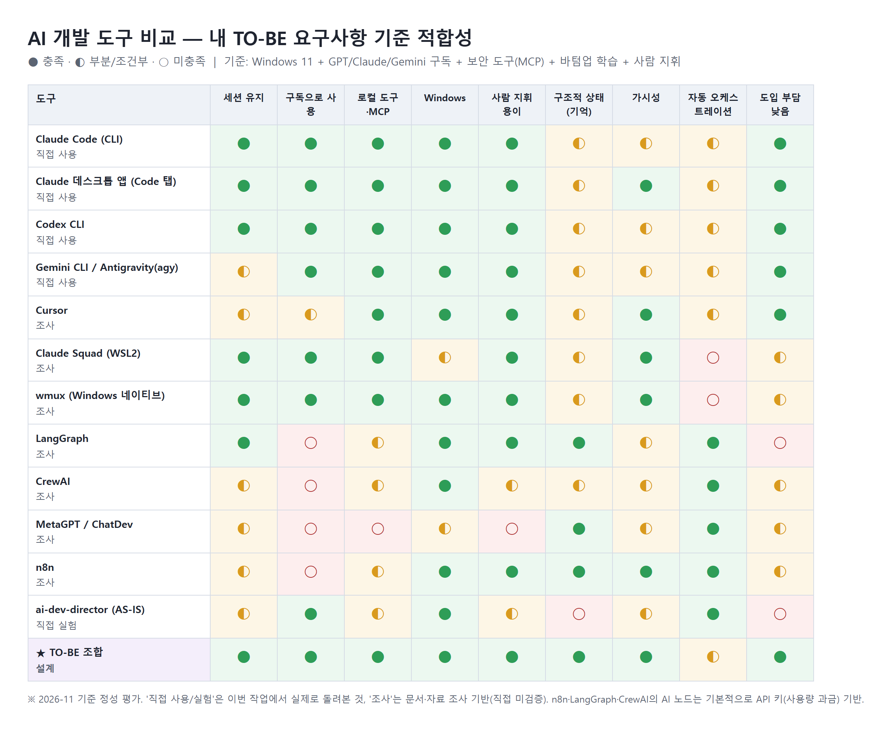
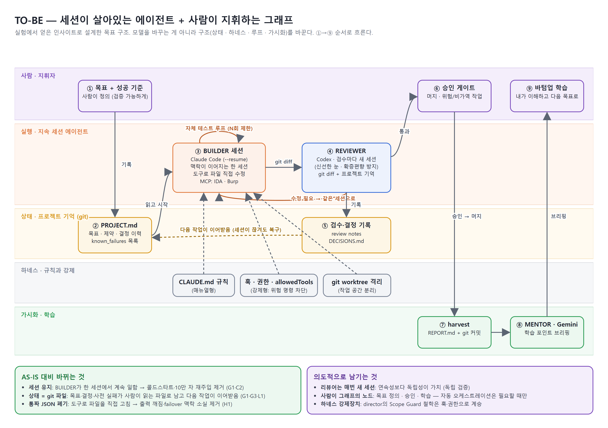

# 5. AI 도구 비교와 TO-BE — 무엇을 조합할 것인가

> 4장의 TO-BE 요구사항을 기준으로 지금 쓸 수 있는 도구들을 비교하고, TO-BE의 각 칸을 어떤 도구로 채울지 정한다.
> ⚠️ 2026-11 기준. **직접 사용/실험**한 도구와 **문서·자료 조사**만 한 도구를 구분해 표시했다. 조사 항목은 실제 도입 전에 공식 문서로 확인해야 한다.

[← 4. AS-IS → TO-BE 리포트](04_AS-IS_TO-BE_리포트.md) · [목차](README.md) · [다음: 6. 사용한 오픈소스 →](06_사용한_오픈소스와_라이선스.md)

---

## 5.1 비교 기준 = TO-BE 요구사항

| # | 요구사항 | 왜 필요한가 (근거) |
|---|---|---|
| R1 | **세션 유지** | 콜드스타트·10만 자 재주입·대행 시 맥락 소실 제거 (G1 · C2 · H1) |
| R2 | **구독으로 사용** | GPT/Claude/Gemini 구독 보유, API 사용량 과금 회피 |
| R3 | **로컬 도구·MCP** | IDA Pro · Burp 등 보안 도구 연결, 로컬 파일 직접 수정 (T4) |
| R4 | **Windows** | 작업 환경 Windows 11 |
| R5 | **사람 지휘 용이** | 기준 정의·승인·바텀업 학습 (I9 · T10) |
| R6 | **구조적 상태(기억)** | 세션이 끊겨도 이어받는 프로젝트 기억 (T6) |
| R7 | **가시성** | 무엇이 왜 일어났는지 보여야 원인을 판별 (I7) |
| R8 | 자동 오케스트레이션 | 필수 아님 — 반복 업무 확장 단계에서만 |
| R9 | **도입 부담 낮음** | 오케스트레이터를 직접 유지하는 비용 회피 |

## 5.2 도구 지형도 — 세션과 상태를 어떻게 다루나

| 갈래 | 도구 | 세션·상태를 다루는 방식 | 경험 |
|---|---|---|---|
| **CLI 에이전트 (하네스)** | Claude Code | 로컬 세션 저장 + `--resume`, CLAUDE.md, 훅, 서브에이전트, MCP, 헤드리스 `-p` | 직접 |
| | Codex CLI | 세션 + `codex resume`, AGENTS.md, `exec` 헤드리스, 샌드박스 | 직접 |
| | Gemini CLI / Antigravity(`agy`) | stream-json 입출력, 모델 지정 가능 | 직접 |
| **데스크톱 앱** | Claude 데스크톱 앱 (Code 탭) | Claude Code를 GUI로 — 여러 세션 병렬, 로컬 폴더·MCP·브라우저 | 직접 (이 문서 작성 환경) |
| **AI IDE** | Cursor | 편집기 안의 에이전트, 규칙 파일, MCP — 별도 구독 | 조사 |
| **병렬 세션 매니저** | Claude Squad | 에이전트마다 tmux 세션 + git worktree, 사람이 지휘 (Windows는 WSL2 필요) | 조사 |
| | wmux | Windows 네이티브로 여러 CLI를 나란히 | 조사 |
| **상태영속 프레임워크** | LangGraph | checkpointer(스레드별 상태 저장·재개) + store(장기 기억) — 상태 관리의 정석, 주로 API | 조사 |
| | CrewAI | 역할 기반 에이전트, 메모리·체크포인트 추가 — 주로 API | 조사 |
| **AI 사무실형** | MetaGPT / ChatDev | 공유 메시지풀(역할별 구독) / chat chain + memory stream — 주로 API, 자동 진행 | 조사 |
| **워크플로 그래프** | n8n | 노드·엣지를 시각적으로 연결, 승인 대기 노드 — AI 노드는 API 키 | 조사 |
| **오케스트레이터** | ai-dev-director | 상태기계 + 1회성 헤드리스 호출 + JSON 파일 전달 | 직접 실험 |

## 5.3 적합성 매트릭스

**읽는 법**
- 위쪽 **CLI 에이전트·데스크톱 앱**은 R1~R5, R9를 거의 다 충족한다. 부족한 건 **R6(구조적 상태)** 인데, 이건 도구가 아니라 **프로젝트 기억 파일(템플릿)** 로 채운다.
- **LangGraph·n8n**은 R6·R8(상태·자동화)이 강하지만 R2(구독)가 약하다 → 개발 과제 본체가 아니라 **반복 업무 확장용**.
- **MetaGPT·ChatDev**는 '메시지풀/역할별 구독' 아이디어(R6)가 훌륭하지만 자동 진행·API 기반이라 내 용도와 거리가 있다 → **아이디어만 차용**(프로젝트 기억 = 메시지풀).
- **ai-dev-director**는 구독·자동화는 되지만 R1·R6에서 무너졌다(3장).

## 5.4 도구별 한 줄 평가

| 도구 | 강점 | 약점 | TO-BE에서의 위치 |
|---|---|---|---|
| Claude Code / 데스크톱 앱 | 세션·훅·MCP·로컬 수정 모두 기본 제공, 이번 실험에서 IDA MCP 동작 확인 | 구독 한도 | **BUILDER 세션 본체** |
| Codex CLI | 다른 회사 모델 → 독립 검수에 유리, 이번 실험에서 원인 분석이 정확 | 단독 개발 시 Claude보다 느린 경우 관찰(대행 타임아웃) | **REVIEWER** (검수마다 새 세션) |
| Gemini / agy | 모델 지정 가능, 긴 문서 요약 | 세션 재개 방식 확인 필요 | **MENTOR · 리서치** |
| Claude Squad / wmux | 여러 세션을 한 화면에서 지휘 | Squad는 WSL2 필요, 둘 다 직접 검증 전 | 병렬 작업이 많아지면 **선택적 추가** |
| Cursor | 편집기 통합 UX | 별도 구독, 내 구독 3개와 중복 | 사용 안 함 |
| LangGraph / n8n | 상태영속·그래프 자동화의 정석 | API 과금, 코드/설정 부담 | **Phase 4 반복 업무** |
| MetaGPT / ChatDev | 역할별 정보 구독 개념 | 자동 진행, API | **개념만 차용** |
| ai-dev-director | 구조화된 ORDER, Scope Guard, 증거 기록 | 세션 없음, 출력·판정 취약, 유지 비용 | **부품·철학만 계승** (harvest, Scope Guard 개념, 증거 JSON) |

## 5.5 TO-BE를 무엇으로 채우나

| TO-BE 구성요소 | 채우는 도구 | 대안 |
|---|---|---|
| ③ BUILDER 세션 (MCP: IDA·Burp) | **Claude 데스크톱 앱 세션** 또는 Claude Code CLI `--resume` | WSL2 + Claude Squad의 한 pane |
| ④ REVIEWER (신선한 세션) | **Codex CLI** (`codex exec`로 git diff 검수) | Claude 서브에이전트 (같은 회사 모델 → 독립성 낮음) |
| ⑧ MENTOR | **Gemini / agy** (`mentor/` 스크립트) | Claude |
| ② ⑤ 프로젝트 기억 | **git의 Markdown 템플릿** (PROJECT · DECISIONS · known_failures · review notes) | — |
| 하네스 | **CLAUDE.md / AGENTS.md + 훅 + 권한 + worktree** | — |
| ⑦ 가시화 | **`tools/harvest.py`** (이번에 만든 것) + git | — |
| (확장) 반복 업무 그래프 | n8n 또는 LangGraph | — |

> **결론**: TO-BE는 새 도구를 하나 고르는 문제가 아니었다. **이미 세션·하네스·MCP를 갖춘 CLI 에이전트를 역할별로 조합**하고, 빠져 있던 **상태(프로젝트 기억)와 가시성**을 파일과 스크립트로 채우면 된다.
> 직접 만든 오케스트레이터 코드를 유지하는 대신, 검증된 하네스 위에 **얇은 구조(템플릿 + 훅 + harvest)** 를 얹는 방향이다.

## 5.6 활용 형태별 구성

같은 도구라도 작업 성격에 따라 조합 방식이 달라진다. 실험 결과를 바탕으로 정리했다.

| 형태 | 구성 예 | 잘 맞는 작업 | 비용·주의 |
|---|---|---|---|
| **사람 지휘형** | Claude 데스크톱 앱 또는 Claude Code CLI 세션(구현, `--resume`) + Codex CLI(검수, 매번 새 세션) + 프로젝트 기억 문서 | 탐색적 개발, 큰 멀티파일 변경, MCP 도구를 쓰는 분석, 학습 | 추가 설치 없음. 사람이 흐름을 지휘 |
| **병렬 세션형** | 여러 CLI 세션을 git worktree별로 분리 — 데스크톱 앱의 다중 세션, 또는 WSL2 + Claude Squad / wmux | 서로 독립적인 작업 여러 개를 동시에 | Claude Squad는 Windows에서 WSL2 필요 |
| **자동 오케스트레이터형** | ai-dev-director 같은 상태기계 기반 도구 | 기준이 명확하고 테스트가 갖춰진 작은 단위 변경 | 성공 기준·기존 실패 목록 정비가 선행돼야 함, 유지 비용 |
| **워크플로 그래프형** | n8n, LangGraph | 정형화된 반복 업무 | 주로 API 사용량 과금 |

---

## 참고 자료
- 개념: 보스턴빌더「[하네스·루프·그래프 엔지니어링?](https://www.youtube.com/watch?v=uKbw2Lfn3wI)」(2026-11-04)
- LangGraph persistence: https://docs.langchain.com/oss/python/langgraph/persistence
- 프레임워크 비교: https://galileo.ai/blog/autogen-vs-crewai-vs-langgraph-vs-openai-agents-framework
- MetaGPT 논문: https://arxiv.org/pdf/2308.00352
- ChatDev ChatChain (IBM): https://www.ibm.com/think/tutorials/chatdev-chatchain-agent-communication-watsonx-ai
- Claude Squad: https://github.com/smtg-ai/claude-squad · Windows(tmux) 이슈: https://github.com/smtg-ai/claude-squad/issues/275
- wmux: https://dev.to/wong2kim/wmux-run-claude-code-codex-and-gemini-cli-side-by-side-on-windows-pkg

[← 4. AS-IS → TO-BE 리포트](04_AS-IS_TO-BE_리포트.md) · [목차](README.md) · [다음: 6. 사용한 오픈소스 →](06_사용한_오픈소스와_라이선스.md)
