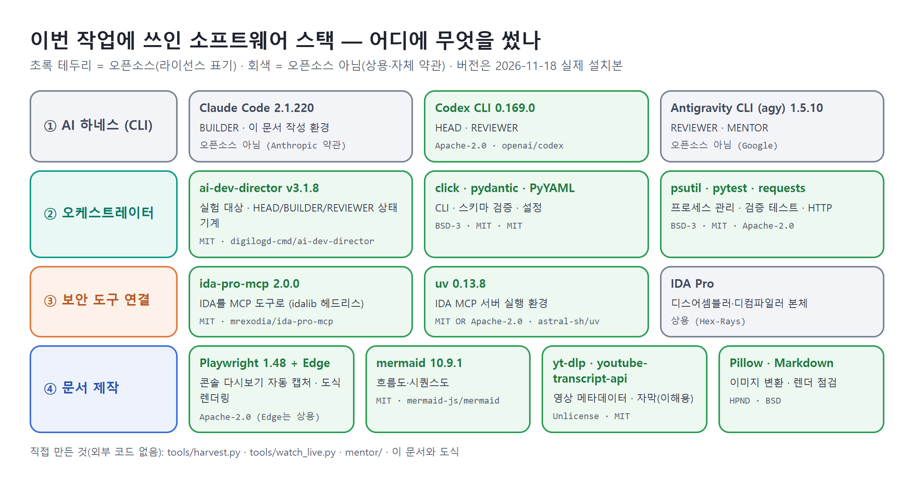

# 6. 사용한 오픈소스와 라이선스

> 이 작업에 쓴 소프트웨어를 **실제 설치본에서 확인한 버전·라이선스** 기준으로 정리했다 (2026-11-18 확인).
> 이 레포에 **제3자 코드가 포함되는 경우** 라이선스 원문을 [`../THIRD_PARTY_LICENSES/`](../THIRD_PARTY_LICENSES/)에 함께 두었다.

[← 5. 도구 비교](05_AI툴비교와_TO-BE.md) · [목차](README.md)

---

## 6.1 한눈에 보기

| 이름 | 버전 | 라이선스 | 저작권자 / 저장소 | 이 작업에서의 역할 | 레포에 코드 포함 |
|---|---|---|---|---|---|
| **ai-dev-director** | v3.1.8 (`d2541ad`) | **MIT** | © 2026 DAVZD · [digilogd-cmd/ai-dev-director](https://github.com/digilogd-cmd/ai-dev-director) | **실험 대상 오케스트레이터** — HEAD/BUILDER/REVIEWER 상태기계, 콘솔(TRINITY) | 일부 (아래 6.2) — [원문](../THIRD_PARTY_LICENSES/ai-dev-director_MIT.txt) |
| **ida-pro-mcp** | 2.0.0 (플러그인 0.1.0) | **MIT** | © 2025 Duncan Ogilvie · [mrexodia/ida-pro-mcp](https://github.com/mrexodia/ida-pro-mcp) | IDA Pro를 MCP 도구로 연결 (idalib 헤드리스) | 없음 (사용만) — [원문](../THIRD_PARTY_LICENSES/ida-pro-mcp_MIT.txt) |
| **Codex CLI** | 0.169.0 | **Apache-2.0** | OpenAI · [openai/codex](https://github.com/openai/codex) | HEAD · REVIEWER · failover 대행 BUILDER | 없음 |
| **uv** | 0.13.8 | MIT OR Apache-2.0 | Astral · [astral-sh/uv](https://github.com/astral-sh/uv) | IDA MCP 서버 실행 환경 | 없음 |

> **오픈소스가 아닌 도구** (사용만 했고 재배포하지 않음): Claude Code 2.1.220 (Anthropic 이용약관 — 패키지 라이선스 표기 "SEE LICENSE IN README"), Antigravity CLI `agy` 1.5.10 (Google, 실행 파일 배포·라이선스 파일 없음), IDA Pro (Hex-Rays 상용 — 정식 라이선스 필요), Microsoft Edge (헤드리스 캡처용).

## 6.2 ai-dev-director — 어떻게 썼고 무엇이 이 레포에 들어 있나

| 항목 | 내용 |
|---|---|
| 무엇인가 | 구독 CLI만으로 HEAD(설계·판정) · BUILDER(구현) · REVIEWER(검수)를 돌리는 Windows 우선 Python 오케스트레이터. git worktree 격리, Scope Guard, 검증 게이트, failover, TRINITY 콘솔 |
| 사용 방식 | ① 원본을 `ai-dev-director-inspect/`에 받아 엔진으로 사용 ② 복사본(`director-lab/`)을 **실험 대상 저장소**로 삼아 "director에게 director 자신을 고치게" 하는 도그푸딩 ③ 실행 기록과 콘솔 화면을 분석 |
| 내가 한 로컬 수정 | agy 호출에 `--model` 지정 추가(`core/research_runner.py`), 콘솔 시작 스크립트의 Python 경로 수정, 이후 Codex와 함께 HEAD 세션 연속성(`core/head_sessions.py`) 실험 — **엔진 자체와 이 수정본은 이 레포에 포함하지 않음** |
| 이 레포에 들어 있는 관련물 | `analysis-mode/` — director 위에서 동작하도록 오케스트레이션이 생성한 확장 코드와 실행 기록 / `AI오케스트레이션/assets/evidence/` — director 실행 기록(JSON·로그) 원본 / 문서 안의 짧은 코드 인용(파일명·함수명·설정 한 줄) / 콘솔 화면 캡처 |
| 고지 | MIT 조건에 따라 저작권·허가 고지 원문을 [`THIRD_PARTY_LICENSES/ai-dev-director_MIT.txt`](../THIRD_PARTY_LICENSES/ai-dev-director_MIT.txt)에 포함 |

## 6.3 director의 Python 의존성 (실행 환경에 설치된 버전)

| 패키지 | 버전 | 라이선스 | 용도 |
|---|---|---|---|
| click | 8.5.1 | BSD-3-Clause | CLI 명령 (`director.py do`) |
| pydantic | 2.14.3 | MIT | ORDER·결과 스키마 검증, Finding 스키마 |
| PyYAML | 6.0.3 | MIT | `config.yaml` 읽기 |
| psutil | 7.2.2 | BSD-3-Clause | CLI 프로세스 트리 관리·타임아웃 |
| pytest | 9.2.0 | MIT | 검증 단계 테스트 실행 |
| requests | 2.34.2 | Apache-2.0 | director 자체 테스트 의존성 — 누락 시 테스트 0개 수집 (3장 E1) |

## 6.4 문서 제작에 쓴 도구

| 도구 | 버전 | 라이선스 | 용도 |
|---|---|---|---|
| Playwright (Python) | 1.48 / 1.65 | Apache-2.0 | 콘솔 다시보기 자동 캡처(1초 간격), HTML·mermaid 도식을 PNG로 렌더링 (중간에 Edge가 157로 업데이트돼 1.65로 교체) |
| mermaid | 10.9.1 (jsDelivr CDN) | MIT · [mermaid-js/mermaid](https://github.com/mermaid-js/mermaid) | 흐름도·상태도·시퀀스도 |
| yt-dlp | 2024.10.22 | Unlicense | 영상 제목·챕터 메타데이터 (영상 파일은 받지 않음) |
| youtube-transcript-api | 1.2.5 | MIT | 자동 생성 자막 텍스트 (이해용, 문서에 원문 미수록) |
| Pillow | 10.4.0 | HPND | 캡처 JPG 변환·검수용 컨택트시트 |
| Markdown (Python) | 3.7 | BSD | 문서 렌더링 점검 |

## 6.5 조사·비교만 하고 사용하지 않은 것

5장 비교에 등장하지만 **설치하거나 코드를 쓰지 않은** 프로젝트. 도입할 때 각 저장소의 라이선스를 확인해야 한다.

| 이름 | 저장소 | 비고 |
|---|---|---|
| Claude Squad | [smtg-ai/claude-squad](https://github.com/smtg-ai/claude-squad) | README 기준 **AGPL-3.0** — 수정해서 배포하면 소스 공개 의무 |
| LangGraph · CrewAI · AutoGen | 각 공식 저장소 | 상태영속 비교 대상 (AutoGen은 유지보수 모드) |
| MetaGPT · ChatDev | 각 공식 저장소 | 'AI 사무실' 개념 비교 |
| cmux · wmux · n8n | 각 공식 사이트 | 병렬 세션·그래프 도구 비교 |

## 6.6 직접 만든 것 (외부 코드 없음)

| 경로 | 내용 |
|---|---|
| [`../tools/harvest.py`](../tools/harvest.py) | director 실행 기록 → 사람용 REPORT.md + git 커밋 |
| [`../tools/watch_live.py`](../tools/watch_live.py) | 실행 중 런을 실시간 관전 |
| [`../mentor/`](../mentor/) | 바텀업 학습 브리핑(MENTOR) 프롬프트·스크립트 |
| `AI오케스트레이션/` 문서와 `assets/diagrams/` | 이 문서와 도식 18+1장 |

## 6.7 콘텐츠 출처
- 개념 정리의 기반: 보스턴빌더 | AI 시대 생존기「[하네스·루프·그래프 엔지니어링? | 비개발자도 20분안에 완벽히 이해하기](https://www.youtube.com/watch?v=uKbw2Lfn3wI)」(2026-11-04). 영상 화면·대본 원문은 싣지 않았고, 내용을 직접 다시 정리·도식화했다.
- 프레임워크 비교의 참고 자료는 [5장 참고 자료](05_AI툴비교와_TO-BE.md#참고-자료) 참조.

[← 5. 도구 비교](05_AI툴비교와_TO-BE.md) · [목차](README.md)
