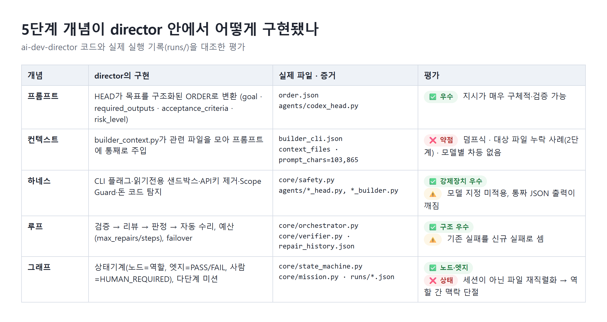

# AI 오케스트레이션 실험 문서

여러 AI에게 역할을 나눠 협업시키는 오케스트레이션을 실제 개발 과제에 적용하고, 실패 원인을 실행 기록으로 분석해 개선 구조를 설계한 과정을 정리한 문서다.
프로젝트 전체 개요와 처음 가졌던 질문은 [레포 첫 페이지](../README.md)에 있다.

| 항목 | 내용 |
|---|---|
| 핵심 질문 | AI에게 일을 잘 시키려면 어떤 구조가 필요한가? 여러 AI를 엮으면 실제로 더 잘하는가? 안 된다면 어디서 막히는가? |
| 환경 | Windows 11 · GPT / Claude / Gemini **구독 CLI** (API 과금 없음) · IDA Pro MCP |
| 실험 대상 | 오픈소스 오케스트레이터 `ai-dev-director` (HEAD=Codex, BUILDER=Claude, REVIEWER=Antigravity) |
| 실험 과제 | director에게 **director 자신을 고치게** 함 — "IDA Pro MCP를 쓰는 analysis 모드 추가" (도그푸딩) |
| 1장 참고 출처 | 보스턴빌더 \| AI 시대 생존기「[하네스·루프·그래프 엔지니어링? \| 비개발자도 20분안에 완벽히 이해하기](https://www.youtube.com/watch?v=uKbw2Lfn3wI)」(2026-11-04) — 단계 구분을 참고했고, 내용은 이번 실험에서 이해한 방식으로 재구성 |
| 사용한 오픈소스 | [ai-dev-director](https://github.com/digilogd-cmd/ai-dev-director) v3.1.8 (MIT) · [ida-pro-mcp](https://github.com/mrexodia/ida-pro-mcp) 2.0.0 (MIT) · [Codex CLI](https://github.com/openai/codex) 0.169.0 (Apache-2.0) 외 — 전체 목록·라이선스는 [6장](06_사용한_오픈소스와_라이선스.md) |

*위: 프롬프트·컨텍스트·하네스·루프·그래프 다섯 단계가 오케스트레이터(ai-dev-director)에 각각 어떻게 구현됐고 어디가 약한지 — 구조를 파악하고 한계를 확인한 결과.*

---

## 문서 구성

| # | 문서 | 답하는 질문 | 주요 시각자료 |
|---|---|---|---|
| 0 | [AI 작동원리](00_AI_작동원리.md) | AI는 어떻게 답을 만들고, 왜 "기억"을 못 하나? 웹·앱·CLI는 뭐가 다른가? | LLM 추론 · 학습 3단계 · 무상태 · 에이전트 루프 · 웹/앱/CLI |
| 1 | [AI에게 일 시키는 구조 5단계](01_AI에게_일시키는_구조_5단계.md) | 프롬프트→컨텍스트→하네스→루프→그래프는 왜 생겼고, 오케스트레이션은 무엇을 구현한 것인가? | 진화도 · 하네스 · 루프 · 그래프 · 개념↔director 매핑 |
| 2 | [오케스트레이션 실제 동작 증적](02_오케스트레이션_실제동작_증적.md) | 실제 화면에서 단계별로 무엇이 돌고, 어떤 JSON이 오가며, AI끼리 무슨 말을 했나? | **GUI 단계별 캡처 12장** · 상태기계 · JSON 시퀀스 · AI 대화 로그 |
| 3 | [실험 기록과 실패 지점](03_실험기록과_실패지점.md) | 무엇을 실험했고 어디서 왜 실패했나? (16개 실패를 층위별로) | 실패 지점 지도 · 타임라인 · 증거 캡처 |
| 4 | [**AS-IS → TO-BE 리포트**](04_AS-IS_TO-BE_리포트.md) | 핵심 인사이트는? 어떤 과제를 풀어 어떤 구조로 가야 하나? | **AS-IS 구조도 · TO-BE 구조도 · 전환 로드맵** |
| 5 | [AI 도구 비교와 TO-BE](05_AI툴비교와_TO-BE.md) | 지금 좋은 도구들은 TO-BE와 비교해 어떤가? 무엇을 조합하나? | 적합성 매트릭스 |
| 6 | [사용한 오픈소스와 라이선스](06_사용한_오픈소스와_라이선스.md) | 어떤 오픈소스를 어디에 썼고, 라이선스는 무엇이며 이 레포에 무엇이 포함됐나? | 소프트웨어 스택 |

**읽는 순서**: 개념이 익숙하면 **4번 리포트 → 3번 → 2번** 순으로 거꾸로 읽어도 된다. 4번이 모든 인사이트의 결론이다.

## 핵심 정리

**구조 — 돌려 보며 파악한 것**
1. **AI끼리 직접 대화하지 않는다.** 오케스트레이터가 지시서·결과·검수 의견을 JSON 파일로 만들어 다음 AI에게 넘긴다(2장).
2. **오케스트레이터는 다섯 단계(프롬프트→컨텍스트→하네스→루프→그래프)를 역할 분리 + 상태 흐름으로 구현한 것**이다(1장).
3. **지시보다 강제가 확실하고, 검수자를 분리하면 효과가 있다.** 허용 경로 검사는 어떤 AI든 지켰고, 별도 검수가 지어낸 CLI 옵션·추측으로 쓴 테스트를 걸러냈다(1장·3장).

**한계 — 구조에서 비롯된 문제**
4. **기억이 이어지지 않는다.** AI는 원래 기억하지 않고(0장), 매번 한 번씩 호출하는 구조라 단계마다 처음부터 시작한다. 가장 근본적인 한계다(4장).
5. **역할별 최적화가 없다.** 역할별 모델이 강제되지 않고, 어떤 모델이든 파일을 통째로 밀어 넣는다. 필요한 파일이 빠지면 추측으로 채운다(3장).
6. **결과 전달과 판정이 경직돼 있다.** 결과를 한 덩어리 JSON으로 주고받으면 크면 깨지고, 판정 규칙이 경직되면 동작하는 결과도 떨어진다(3장).
7. **완전 자동은 과정과 결과를 숨긴다.** 그래서 기억이 이어지는 에이전트 + 사람이 지휘하는 흐름 + 독립 검수 + 사람이 읽는 기록이 필요하다(4장 TO-BE).

## 증적 자료 (재현·검증 가능)

| 폴더 | 내용 | 만든 방법 |
|---|---|---|
| [`assets/gui/`](assets/gui/) | TRINITY 콘솔 실제 화면 12장 | 콘솔의 **다시보기(실제 기록 29분 → 24배속 재생)** 를 Edge 헤드리스로 1초마다 자동 캡처 후 단계 전환 프레임 선택 |
| [`assets/evidence/`](assets/evidence/) | 두 런의 원본 JSON·run.log | `runs/RUN-*/`에서 그대로 복사 (가공 없음) |
| [`assets/diagrams/`](assets/diagrams/) | 개념도·구조도 19장 | 실험 데이터를 바탕으로 직접 작성 (HTML/mermaid → PNG) |
| [`../analysis-mode/`](../analysis-mode/) | 오케스트레이션이 만든 실제 결과물 + REPORT | `tools/harvest.py`로 수확 |

## 관련 산출물
- [`../tools/harvest.py`](../tools/harvest.py) — 실행 기록을 사람이 읽는 리포트로 수확 + git 커밋
- [`../tools/watch_live.py`](../tools/watch_live.py) — 에이전트 협업 실시간 관전
- [`../mentor/`](../mentor/) — 개발 후 바텀업 학습 포인트를 잡아주는 MENTOR 역할
