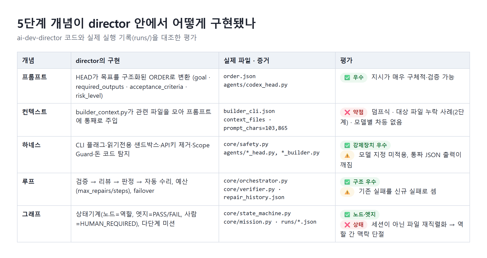

# AI 오케스트레이션 실험

설계·구현·검수를 나눈 CLI 에이전트가 같은 개발 과제를 어떻게 처리하는지 실행 기록과 테스트로 확인한 개인 실험입니다.

2026년 11월 · 실험 설계, 실행 기록 분석, 개선안 작성

[세 차례 실험 결과](AI오케스트레이션/03_실험기록과_실패지점.md) · [두 번째 실행 보고서](analysis-mode/REPORT.md)

한 실행에서는 구현 파일이 생겼지만 테스트가 0건으로 기록됐습니다. 파일 변경, 테스트 출력, 검수 의견을 따로 확인하고, 실행된 테스트가 있을 때 결과를 판정하도록 개선안을 정리했습니다.

## 작업 기록

- [역할과 실행 흐름](AI오케스트레이션/02_오케스트레이션_실제동작_증적.md)에서 설계·구현·검수 사이에 어떤 기록이 오가는지 볼 수 있습니다.
- [실패 원인과 개선 설계](AI오케스트레이션/04_AS-IS_TO-BE_리포트.md)에서 실험 결과를 바탕으로 검수와 테스트 판정을 어떻게 바꾸기로 했는지 설명합니다.
- [실행 기록 수집 도구](tools/README.md)에서 지시, 변경 내역, 검증 출력을 모으는 방법을 볼 수 있습니다.

[사용한 오픈소스와 라이선스](AI오케스트레이션/06_사용한_오픈소스와_라이선스.md)
